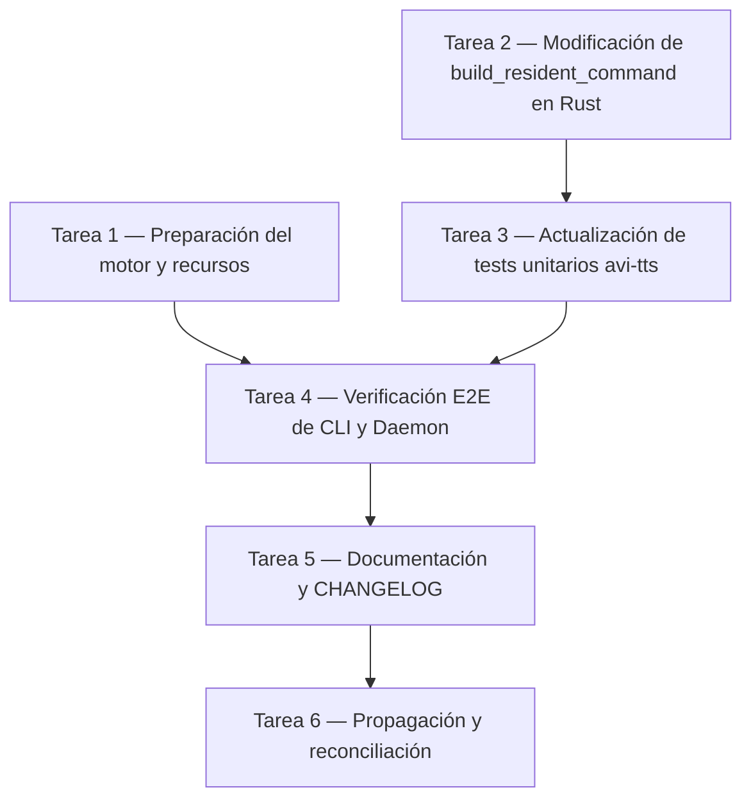

# Plan: Adopción y propagación de cuantización mixta (`--quant-mixed`) en el motor TTS, daemon y CLI

## Contexto del proyecto

AI Voice-InterConnector utiliza `Qwen3-TTS-12Hz-0.6B-Base` para voces clonadas y `Qwen3-TTS-12Hz-0.6B-CustomVoice` para presets, localmente en la CPU del usuario. En la configuración histórica de producción, el proceso servidor residente de inferencia arranca en formato de punto flotante de 16 bits (`BF16`) con 4 hilos de CPU (`-j 4`).

En pruebas de rendimiento sobre hardware de referencia (AMD Ryzen 7 5825U, 8 núcleos / 16 hilos, 32 GB RAM en Windows 11), el motor en `BF16` presenta una latencia mediana de **1,84× RTF** (Real-Time Factor), lo que significa que generar 1 segundo de voz toma aproximadamente 1,84 segundos.

El motor en C puro (`vendor/qwen3-tts`) ya cuenta con la bandera `--quant-mixed`, la cual aplica cuantización mixta:
- Cuantiza el modelo principal (**Talker**, 28 capas) a **INT4** para reducir el coste de inferencia.
- Mantiene el predictor de códigos (**Code Predictor**, 5 capas) en **INT8**, en lugar del INT4 global que presentó problemas en el modelo 0.6B.

En las pruebas registradas en `docs/reports/tts-cpu-optimization.md`, con cuatro hilos el RTF mediano del servidor pasó de 1,84× en BF16 a **1,38×** en cuantización mixta: la razón medida de tiempo por petición fue 0,748, aproximadamente un 25 % menos. En servidor, el valor 1,22× y la reducción cercana al 36 % corresponden a seis hilos, perfil fuera del alcance de este plan. El informe también registra ~36 % menos para una medición distinta: ejecución directa del motor con cuatro hilos. No se debe trasladar esa cifra a la ruta residente de la CLI del producto. Son resultados de un único equipo, no una garantía para otros.

La evaluación inicial de calidad con cuatro hilos (100 elementos) también incumplió las reglas predefinidas: WER agregado +0,82 puntos porcentuales y peor elemento +6 palabras. La confirmación ampliada de 350 síntesis y la escucha ciega corresponden a seis hilos, no al perfil de cuatro hilos de este plan. La escucha no detectó una diferencia audible con un oyente y pocos pares; esto no demuestra equivalencia perceptiva. La confirmación con seis hilos registra incumplimientos de umbrales de identidad y WER por elemento y dos salidas largas de 350. Estas limitaciones y el comportamiento dependiente de la petición anterior deben conservarse al interpretar la estabilidad.

Sin embargo, el código del producto en Rust (`crates/avi-tts/src/lib.rs`) aún no propaga esta bandera y sigue lanzando el proceso residente en `BF16`.

---

## Tabla de contenidos

1. Contexto del proyecto
2. Consideraciones fundamentales para el razonamiento y diseño del plan
3. Propósito del plan
4. Objetivos del plan
5. Fase de ejecución
   - Tarea 1 — Preparación del binario y de los recursos de prueba
   - Tarea 2 — Actualización del constructor de comandos residente en `avi-tts`
   - Tarea 3 — Actualización y validación de la suite de pruebas unitarias de Rust
   - Tarea 4 — Verificación de extremo a extremo en la CLI y el Daemon
   - Tarea 5 — Actualización de documentación técnica y registro de cambios
   - Tarea 6 — Propagación y reconciliación de cambios en el proyecto
6. Dependencias y orden de ejecución
7. Fase de cierre

---

## Consideraciones fundamentales para el razonamiento y diseño del plan

- **Alcance de la evidencia:** No usar `--int4` global. El informe no observó truncamientos en 150 respuestas del servidor con cuantización mixta, pero sí dependencia de la petición anterior también en BF16; no se garantiza determinismo ni ausencia universal de anomalías.
- **Arquitectura de lanzamiento:** Tanto la CLI como el daemon delegan el argv del residente en `avi_tts::resident::build_resident_command`; la selección del perfil y el entorno también deben propagarse por la cadena que lo llama. El constructor compartido no garantiza por sí solo que cada ruta reciba el perfil correcto.
- **Preservación de interfaces de voz (`.qvoice`):** La carga de voces clonadas (`--graft` y `--load-voice`) y la extracción x-vector (`--ref-audio` y `--xvector-only`) conservan sus interfaces y formato de archivo; la cuantización puede modificar las muestras generadas y no exige identidad byte a byte.
- **Perfil y reversibilidad:** `AVI_TTS_PRECISION` selecciona el perfil al crear el motor: ausente o exactamente `mixed` activa cuantización mixta; exactamente `bf16` selecciona BF16. Todo otro valor, incluidos cadena vacía, espacios, variantes de mayúsculas y un valor no convertible a Unicode, produce un error explícito; no normalizar ni aplicar fallback. La CLI directa lee el perfil al crear su motor; el daemon lo fija al arrancar y cambiarlo exige reiniciarlo. Una petición no modifica el perfil de un daemon ya activo. El perfil se refiere a los pesos del Talker y Code Predictor, no a la precisión de todo el pipeline: por ejemplo, `QWEN_SD_INT8` controla una ruta independiente del decoder y no se modifica.
- **Entorno del residente:** El lanzador hereda el entorno y permite sustituir variables del hijo. Para ambos perfiles pasar `QWEN_CP_LMHEAD_PREC=""`, `QWEN_CP_LAYER_PREC=""` y `QWEN_CP_Q2_FFN=""`. Para `mixed`, pasar `QWEN_TALKER_PREC=int4` y `QWEN_CP_PREC=int8` junto con `--quant-mixed`; para `bf16`, pasar `QWEN_TALKER_PREC=bf16` y `QWEN_CP_PREC=bf16` sin `--quant-mixed`, `--int4` ni `--int8`. Con cadenas vacías, las comprobaciones del motor no aplican los ajustes por capa/cabezal ni seleccionan Q2. `--quant-mixed` establece también `QWEN_CP_PREC=int8` dentro del hijo. No modificar el entorno global ni el lanzamiento de clonado.
- **Voces:** `default` es la voz clonada del usuario; `ryan` y `vivian` son presets de CustomVoice. El informe evaluó voces clonadas Base, no los presets. El `default/reference.qvoice` instalado y el asset de fábrica tienen el mismo SHA-256 al revisar el plan; volver a compararlos antes de usar una raíz aislada, pues la voz instalada puede cambiar.
- **Puerta de calidad acotada:** Comparar ambos perfiles con una voz clonada y un preset, en español e inglés, antes de declarar la adopción. La prueba detecta defectos evidentes, no demuestra equivalencia estadística ni sustituye la campaña histórica. La escucha requiere un evaluador humano: un agente sin acceso a la reproducción o sin veredicto del oyente debe marcarla como pendiente y no aprobarla por inferencia.
- **Warmup por voz:** El daemon conserva un solo residente y lo reemplaza cuando cambia la voz; el estado `warm` no demuestra que el residente actual corresponda a otra voz. Las mediciones calientes de cada perfil y voz requieren una síntesis previa de esa misma voz y registrar el PID del residente para comprobar su reutilización.
- **Errores de perfil:** La ruta directa traduce hoy cualquier error de `Qwen3TtsEngine::new` a `model_missing`; una precisión inválida no es un modelo ausente. Para ella, emitir `usage_error` con salida 2 y mensaje que nombre `AVI_TTS_PRECISION` y los valores admitidos. En el arranque del daemon conservar el protocolo existente: fallo `startup_failed` en el registro interno, traducido por la CLI a `daemon_error` con salida 1 y el mismo mensaje. Las peticiones `--daemon` usan la configuración del daemon ya iniciado; no validan la variable del cliente. `voice clone --no-daemon` también construye `Qwen3TtsEngine`: una configuración inválida le dará `usage_error`/2 antes de lanzar el clonado; esto no modifica el argv ni el entorno del proceso de extracción cuando el perfil es válido. Las validaciones y comprobaciones de recursos que ocurren antes de construir el motor mantienen su precedencia actual.
- **Binarios y plataformas:** Comprobar el binario efectivamente resuelto por `avi-tts` y las rutas de construcción de distribución; compilar un ejecutable local por sí solo no verifica los artefactos de todas las plataformas.
- **Hechos previos comprobados:** El ejecutable local `vendor/qwen3-tts/qwen_tts.exe` con SHA-256 `b153d167057842559323561b6893bb2e11218368e98929a8c4f92e5b59d85620` reconoce `--quant-mixed`, pasa `--self-test` y comunica AVX2/FMA y OpenBLAS en este equipo. El informe histórico identifica otro binario por el prefijo `eb81d296`; no se ha establecido equivalencia entre ambos. CircleCI usa `cargo xtask build-engine --self-test` o restaura una caché indexada por fuentes, y `cargo xtask package` empaqueta el motor en Windows, Linux y macOS: inspeccionar la definición no prueba los artefactos publicados ni su ejecución.
- **Recursos comprobados al planificar:** En la caché local predeterminada están presentes y no vacíos los archivos exigidos por `MODEL_FILE_PATTERNS` para los snapshots fijados de Base, CustomVoice, Parakeet y ambos modelos de traducción. Esta comprobación de existencia no prueba integridad criptográfica ni carga satisfactoria y puede quedar obsoleta si cambia la caché.
- **Alcance de propagación identificado:** `direct_tts_engine` se usa en `voice clone`, `speech synthesize`, `speech say` y `speech dub`; el lanzador `spawn_engine` se comparte entre el residente y el clonado. Los cambios de perfil, errores y entorno deben revisarse en todas esas vías sin alterar indebidamente el entorno del clonado. También hay documentación de argv en `crates/avi-tts/src/lib.rs` y `docs/DESIGN.md`, contratos en `docs/CLI/` y `USAGE.md`, y pruebas en `tests/cli_golden.rs` y `crates/avi-daemon/tests/golden.rs`.
- **Trabajo preexistente:** Antes de ejecutar, guardar en un directorio temporal nuevo bajo `C:\Users\Cristian\AppData\Local\Temp\opencode` las salidas de `git status --short`, `git diff --binary` y `git diff --cached --binary`; registrar también nombres y SHA-256 de archivos no versionados pertinentes y leer este plan directamente, pues `.work/` puede estar ignorado. Usar esa línea base para separar los cambios existentes de los introducidos por el plan. Durante la planificación ya figuraban preparados `docs/reports/tts-cpu-optimization.md`, `docs/reports/mushra_results.json` y `docs/reports/pares_results.json`: preservarlos íntegramente, salvo la actualización solicitada del informe, y no alterar el índice Git ni descartar trabajo ajeno.
- **Puertas y estado de ejecución:** Las comprobaciones funcionales, la prueba de recursos y la comparación auditiva son puertas distintas. Si una falla o no puede ejecutarse, registrar cuál y su causa; no declarar la adopción completada. Se puede documentar el estado parcial sin presentarlo como adopción ni publicar o desplegar. Para una regresión con el código ya integrado, usar `AVI_TTS_PRECISION=bf16` y reiniciar el daemon de prueba; no modificar instalaciones ajenas ni descartar cambios existentes.

---

## Propósito del plan

El producto sigue iniciando el motor residente en BF16 con cuatro hilos, aunque el motor C ya dispone de una cuantización mixta que redujo el tiempo de síntesis en las pruebas del equipo de referencia. Se propone integrar esa cuantización como perfil predeterminado del residente, tanto en la CLI directa como en el daemon, conservando cuatro hilos y un perfil BF16 seleccionable al inicio. La integración debe permitir una reversión operativa sin recompilar, proteger la configuración efectiva frente a variables heredadas y comprobar el funcionamiento y la calidad con voces clonadas y preset antes de darla por adoptada. El resultado buscado es reducir la latencia de síntesis en CPU manteniendo una alternativa funcional y evidencia trazable de las verificaciones, sin garantizar una mejora o equivalencia de calidad en hardware no evaluado.

---

## Objetivos del plan

1. **Activar la cuantización mixta:** hacer que el residente utilice por defecto `--quant-mixed -j 4`, con Talker INT4 y Code Predictor INT8, tanto en la CLI directa como en el daemon, para voces clonadas y presets.
2. **Mantener una alternativa reversible:** permitir seleccionar BF16 para Talker y Code Predictor mediante `AVI_TTS_PRECISION=bf16` al crear el motor, sin recompilar; mantener el perfil de un daemon activo hasta su reinicio y rechazar configuraciones inválidas con el diagnóstico correspondiente.
3. **Asegurar la configuración y la compatibilidad:** impedir que las variables de precisión heredadas contradigan el perfil elegido mediante ajustes limitados al proceso residente, sin modificar el entorno global, el proceso de clonado ni el formato de las voces `.qvoice` existentes.
4. **Verificar la integración:** comprobar la construcción de argumentos, los dos perfiles, los errores, el entorno del hijo y las rutas dependientes; ejecutar las suites de `avi-tts`, `avi-daemon` y los *golden tests* de la CLI, registrando las pruebas omitidas en lugar de considerarlas aprobadas.
5. **Validar el funcionamiento real:** identificar el binario utilizado y sus capacidades; comprobar el arranque, el *healthcheck* y la síntesis en CLI directa y daemon, además del endpoint de streaming PCM del motor por separado. Registrar las mediciones de ambas rutas y sus condiciones sin equipararlas a resultados históricos distintos.
6. **Aplicar la puerta de calidad acordada:** comparar ambos perfiles en ocho pares de síntesis con la voz clonada `default` y el preset `ryan`, en español e inglés y por las dos rutas. Impedir declarar la adopción completada si la escucha o las comprobaciones de audio no se realizan o detectan defectos claros, sin presentar esta muestra como prueba de equivalencia estadística.
7. **Propagar y documentar el cambio:** identificar y corregir la deriva atribuible a la integración en código, pruebas, comentarios y documentación, sincronizar y comprobar el índice del proyecto, y repetir las verificaciones afectadas. Actualizar el informe técnico y `CHANGELOG.md` con el comportamiento y los resultados observados, preservando la evidencia histórica y el trabajo preexistente; no declarar un despliegue que no se haya realizado.

---

## Fase de ejecución

### Tarea 1 — Preparación del binario y de los recursos de prueba

#### Propósito
El ejecutable local ya supera las comprobaciones básicas, pero su hash difiere del binario histórico y el producto puede resolver otro ejecutable. Preparar una referencia explícita del binario y los recursos reales permite atribuir las verificaciones posteriores al motor utilizado.

#### Objetivos
- Usar un binario concreto con `--quant-mixed`, capacidades y autoverificación comprobadas; registrar su SHA-256.
- Verificar la disponibilidad de ambos modelos TTS y de los modelos obligatorios para arrancar el daemon.
- No atribuir al binario local resultados del binario histórico sin verificar equivalencia.

#### Acciones
1. **`vendor/qwen3-tts/qwen_tts.exe`** — Usar su ruta absoluta mediante `QWEN3_TTS_BIN` en las pruebas y registrar SHA-256, `--help`, `--caps` y `--self-test` del ejecutable efectivo. Repetir estas comprobaciones si el archivo cambia; no ejecutar `make clean`, que elimina objetos y binarios existentes.
2. **`crates/xtask/src/main.rs`** — Solo si se necesita reconstruir el motor, usar `cargo xtask build-engine --self-test` tras comprobar que no sobrescribirá trabajo ajeno; no asumir que `make blas` limpia ni que el binario resultante es idéntico al de la campaña.
3. **`crates/avi-shared/src/paths.rs`** — Comprobar que los snapshots `qwen3-tts-0.6b` y `qwen3-tts-0.6b-base` y los modelos obligatorios de `MODEL_REVISIONS` están aprovisionados; no descargar ni modificar recursos sin autorización. Si faltan, detener la verificación real con la causa.
4. **`crates/avi-store/src/lib.rs`** — Localizar la referencia `voices/default/reference.qvoice` en la raíz de datos efectiva anterior al aislamiento y registrar su SHA-256 sin modificarla; la copia y comparación se realizan al crear el entorno de la tarea 4. Si no existe, detener la prueba de calidad con la causa.

#### Verificación
- `--self-test` del binario elegido con salida 0; disponibilidad de ambos modelos y de los requisitos del daemon, o bloqueo identificado.

---

### Tarea 2 — Actualización del constructor de comandos residente en `avi-tts`

#### Propósito
El lanzamiento actual no selecciona ni aísla perfiles de precisión. Integrar la selección y el entorno del residente en Rust permite utilizar cuantización mixta por defecto y recuperar BF16 al reiniciar el proceso correspondiente.

#### Objetivos
- Incluir `"--quant-mixed"` en el vector de argumentos de `build_resident_command`.
- Mantener 4 hilos (`-j 4`) y el argumento de arranque `--stream`, sin afirmar que la ruta de síntesis del producto use streaming PCM.
- Permitir BF16 al inicio y rechazar valores inválidos sin fallback silencioso.
- Ruta de reversión: iniciar el proceso con `AVI_TTS_PRECISION=bf16` y reiniciar el daemon si estaba activo.

#### Acciones
1. **`crates/avi-tts/src/lib.rs`** — En `Qwen3TtsEngine::new`, leer y validar `AVI_TTS_PRECISION` una vez; guardar un perfil tipado en el motor y propagarlo hasta `build_resident_command`. Para `mixed` añadir `--quant-mixed`; para `bf16` omitirlo. Conservar `-d`, `--serve`, `--host`, `-j 4`, `--stream`, `--watch-stdin` y el tratamiento de voz clonada.
2. **`crates/avi-tts/src/lib.rs:1265-1272`** — Documentación de `build_resident_command`:
   Actualizar el docstring para describir los dos perfiles y la selección de argumentos, sin atribuir al argv garantías sobre un entorno no controlado.
3. **`crates/avi-tts/src/lib.rs`** — Aplicar al lanzamiento del residente los cinco overrides exactos de «Entorno del residente», junto a los tres overrides de scratch existentes, mediante `avi_process::spawn_with_allowlist_env`. Mantener intacto el entorno del proceso padre y el lanzamiento de clonado; no ampliar la interfaz de `RestrictedSpawnRequest`, pues la función existente ya acepta overrides.
4. **`vendor/qwen3-tts/main.c`** — Mantener sin cambios el motor C: la bandera `--quant-mixed` ya fija `QWEN_CP_PREC=int8` antes de cargar el modelo.
5. **`docs/DESIGN.md`** — Documentar valores, error por valor inválido, precedencia y momento de lectura de `AVI_TTS_PRECISION`, incluido el reinicio del daemon.
6. **`src/main.rs`** — Clasificar el error tipado de perfil inválido en `direct_tts_engine` como `usage_error` con salida 2, preservando `model_missing` para errores de modelos; conservar el mapeo existente `daemon_error`/1 para el fallo de arranque del daemon.
7. **`docs/CLI/CONTRACT.md`** — Documentar los diagnósticos de perfil inválido y la diferencia entre la configuración de la ruta directa y la del daemon ya iniciado.

#### Verificación
- Revisión de la cadena de selección, argv y entorno; las pruebas de la tarea 3 deben demostrar ambos perfiles y sus errores, no solo la presencia de la bandera.

---

### Tarea 3 — Actualización y validación de la suite de pruebas unitarias de Rust

#### Propósito
Las pruebas existentes solo fijan el argv previo y no comprueban los perfiles ni su entorno. Ampliarlas permite detectar regresiones en la selección, la reversión y los errores antes de evaluar el motor real.

#### Objetivos
- Actualizar los tests unitarios de `avi-tts` para que esperen `"--quant-mixed"`.
- Lograr que pasen las pruebas ejecutadas de `avi-tts`, `avi-daemon` y CLI, indicando por separado las pruebas ignoradas.

#### Acciones
1. **`crates/avi-tts/src/lib.rs:2091-2113`** — Test `build_resident_command_has_threads_and_stream_without_int4`:
   Actualizar el vector esperado en el `assert_eq!` para incluir `"--quant-mixed"` inmediatamente después de `"-j", "4"`.
2. **`crates/avi-tts/src/lib.rs:2115-2140`** — Test con voz clonada:
   Actualizar el vector esperado para la variante que incluye `--load-voice <path> --graft` verificando que `--quant-mixed` se mantenga presente.
3. **`crates/avi-tts/src/lib.rs`** — Añadir pruebas para perfil ausente, `mixed`, `bf16`, valor vacío, espacios, mayúsculas, otro valor y, donde el SO lo permita, valor no Unicode; comprobar argumentos con y sin voz clonada. Probar en un proceso de prueba aislado que, ante valores heredados conflictivos de las cinco variables, el hijo recibe exactamente los overrides del perfil y el padre conserva sus valores; comprobar también que el hijo recibe los tres directorios de scratch y que el clonado no recibe los overrides del residente. La cadena vacía puede llegar al CRT de Windows como variable ausente: ambos estados deben ser aceptados solo para las tres variables que el C comprueba como `valor && *valor` o compara contra cadenas no vacías.
4. **`tests/cli_golden.rs`** — Añadir pruebas aisladas del error de perfil inválido: las rutas directas que construyen el motor, incluido `voice clone --no-daemon`, devuelven `usage_error`/2 cuando alcanzan esa construcción; `daemon start` devuelve `daemon_error`/1 y el mensaje nombra la variable y valores válidos. Una petición a un daemon ya iniciado no cambia su perfil. Preparar los recursos o dobles necesarios para que la ausencia previa de modelos no oculte el caso y comprobar que los errores reales de modelo siguen siendo `model_missing`/4.
5. **`crates/avi-tts/src/lib.rs`** — Ejecutar las pruebas en un proceso aislado sin `AVI_TTS_PRECISION`, `QWEN3_TTS_BIN`, `QWEN3_TTS_MODEL_DIR` ni `QWEN3_TTS_BASE_MODEL_DIR` heredadas, para que ni el perfil ni los recursos externos contaminen los sandboxes; los tests de perfiles alternativos deben fijar sus propios valores en hijos aislados. Ejecutar la suite del crate:
   ```powershell
    cargo test -p avi-tts
    ```
6. **`crates/avi-daemon`** — Ejecutar `cargo test -p avi-daemon` en un proceso con el mismo aislamiento de variables de la acción 5 y registrar pruebas omitidas y sus causas; una prueba omitida no equivale a validación real.

#### Verificación
- `cargo test -p avi-tts` y `cargo test -p avi-daemon` terminan sin fallos; las pruebas ignoradas se enumeran aparte. Las pruebas CLI nuevas se ejecutan en la tarea 4.

---

### Tarea 4 — Verificación de extremo a extremo en la CLI y el Daemon

#### Propósito
Las pruebas de contrato por sí solas no acreditan que el motor real cargue los perfiles ni que la voz resultante sea aceptable. Verificar ambas rutas, el servidor y las muestras comparativas permite atribuir resultados al binario probado y aplicar la puerta de calidad acordada.

#### Objetivos
- Validar síntesis con ambos perfiles, voz clonada y preset, por CLI directa y daemon.
- Verificar salud, precisión efectiva y el endpoint PCM del motor por separado.
- Ejecutar los golden tests y la prueba de recursos identificada, y aplicar la puerta auditiva sin tratar omisiones como éxitos.

#### Acciones
1. **`Cargo.toml`** — Construir `cargo build --release --features full` y usar `target/release/ai-voice-interconnector.exe` en Windows para ambas rutas; las features por defecto están desactivadas y no representan el build distribuido. Requiere las dependencias nativas y modelos ya aprovisionados; no descargarlos automáticamente.
2. **`crates/avi-shared/src/paths.rs`** — Usar una raíz nueva bajo `C:\Users\Cristian\AppData\Local\Temp\opencode` como `AVI_DATA_DIR`, mantener la raíz de modelos existente y elegir un `AVI_DAEMON_PORT` libre distinto del daemon del usuario. Ejecutar `voice list` con el binario release para inicializar las voces; copiar la referencia registrada en la tarea 1 a `<AVI_DATA_DIR>/voices/default/reference.qvoice` y comparar ambos SHA-256 antes de sintetizar. `QWEN3_TTS_BIN` apunta al ejecutable absoluto de la tarea 1; `QWEN3_TTS_MODEL_DIR` y `QWEN3_TTS_BASE_MODEL_DIR` apuntan respectivamente a los snapshots fijados CustomVoice (`85e237c12c027371202489a0ec509ded67b5e4b5`) y Base (`5d83992436eae1d760afd27aff78a71d676296fc`) comprobados en la tarea 1, para impedir que otro modelo hermano del binario tenga precedencia. Fijar estas variables solo en el proceso de prueba aislado; no modificar el original ni detener otra instancia.
3. **`src/main.rs`** — Con `AVI_TTS_PRECISION=mixed`, ejecutar el binario release con `speech synthesize --voice default --text "Hola, esta es una prueba." --target-language es --label prueba-qm-es --no-daemon` y después con `--text "Hello, this is a test." --target-language en --label prueba-qm-en --no-daemon`. Usar `--json` y guardar los valores `audio_path`; no existe `--output` en esta orden.
4. **`crates/avi-shared/src/paths.rs`** — Tras cada arranque de `mixed`, buscar el registro del proceso concreto en `<AVI_DATA_DIR>/logs` y comprobar `Talker Q4_0 quantization done`, `[QWEN_CP_PREC=int8]`, `INT8 quantization done` y `Server listening on http://...`. En los arranques `bf16` de la acción 10, comprobar `[QWEN_TALKER_PREC=bf16]`, `[QWEN_CP_PREC=bf16]` y ausencia de mensajes de cuantización Talker/CP. Copiar cada registro relevante a `<AVI_DATA_DIR>/evidencias` con nombre único antes de que la retención de logs lo pode. Si faltan mensajes, el perfil real queda sin verificar: el código fuente no prueba por sí mismo qué cargó el binario ejecutado.
5. **`docs/CLI/commands/SPEECH.md`** — Usar los `audio_path` informados para comprobar que los WAV sean PCM16 mono a 24 kHz, reproducibles y sin cortes evidentes; `default` es la voz clonada del usuario y `ryan` es un preset.
6. **`tests/cli_golden.rs`** — Ejecutar la suite de pruebas de integración global en otro proceso de prueba aislado, sin heredar `AVI_TTS_PRECISION`, `QWEN3_TTS_BIN`, `QWEN3_TTS_MODEL_DIR` ni `QWEN3_TTS_BASE_MODEL_DIR` de la prueba manual: de otro modo las rutas absolutas de modelos pueden sustituir los modelos falsos del sandbox. Los casos que prueban perfiles fijan sus propios valores en sus hijos:
   ```powershell
    cargo test --test cli_golden
    ```
7. **`tests/cli_golden.rs`** — No interpretar la suite anterior como prueba de inferencia: los tests de recursos están ignorados. En otro proceso aislado con `AVI_TTS_PRECISION=mixed`, `QWEN3_TTS_BIN` apuntando al binario de la tarea 1 y sin los dos overrides `QWEN3_TTS_MODEL_DIR`/`QWEN3_TTS_BASE_MODEL_DIR`, ejecutar específicamente `cargo test --features native-stt --test cli_golden synthesize_short_text_word_error_rate_gate -- --ignored` con motor, modelos TTS, Parakeet y ONNX Runtime provisionados; comprobar que se ejecutó y pasó exactamente un caso, no aceptar cero casos filtrados. Comprueba WAV válido y WER ≤ 0,25 para `Hola mundo` con el `default` inicializado desde el asset del test. Solo atribuirlo a la voz instalada si el SHA-256 registrado en la tarea 1 coincide con el del asset. Si faltan recursos, registrar la puerta como no verificada, no como aprobada.
8. **`docs/CLI/commands/DAEMON.md`** — Con `AVI_TTS_PRECISION=mixed`, iniciar `daemon start` con el mismo binario release, `AVI_DATA_DIR` y puerto aislados; comprobar `daemon status` y `warm`, repetir las síntesis con `--daemon` y etiquetas nuevas. Mantener vivo este daemon para la acción 9; luego detener solo esta instancia antes de cambiar de perfil.
9. **`vendor/qwen3-tts/qwen_tts_server.c`** — Con el daemon aislado desocupado y el residente vivo, ejecutar en PowerShell:
   ```powershell
   $port = (Get-Content -Raw -LiteralPath (Join-Path $env:AVI_DATA_DIR 'daemon.pid') | ConvertFrom-Json).resident_port
   if (-not $port) { throw 'No hay residente registrado en el daemon aislado' }
   curl.exe --fail --silent --show-error "http://127.0.0.1:$port/v1/health"
   if ($LASTEXITCODE -ne 0) { throw 'Falló el healthcheck del residente' }
   $body = Join-Path $env:AVI_DATA_DIR 'stream-request.json'
   Set-Content -LiteralPath $body -Encoding ascii -Value '{"text":"Hola mundo","language":"Spanish","seed":4,"temperature":0.35,"top_k":50,"top_p":1.0,"rep_penalty":1.05}'
   curl.exe --fail --no-buffer --trace-time --trace-ascii (Join-Path $env:AVI_DATA_DIR 'stream-trace.txt') --dump-header (Join-Path $env:AVI_DATA_DIR 'stream-headers.txt') --output (Join-Path $env:AVI_DATA_DIR 'stream.pcm') --header 'Content-Type: application/json' --data-binary "@$body" "http://127.0.0.1:$port/v1/tts/stream"
   if ($LASTEXITCODE -ne 0) { throw 'Falló la petición streaming del residente' }
   ```
   Comprobar HTTP 200, `audio/pcm`, `X-Sample-Rate: 24000`, `X-Sample-Format: s16le`, `X-Channels: 1`, PCM no vacío de longitud par y al menos dos recepciones de datos en la traza; si el transporte agrupa todo en una sola recepción, registrar progresividad no verificada, no inferirla del WAV final. Para escucharlo envolver el PCM como WAV mono PCM16/24 kHz. El endpoint es del motor: `avi-tts` usa `/v1/tts` y NDJSON del daemon es progreso, no streaming PCM.
10. **`docs/reports/tts-cpu-optimization.md`** — Comparar perfiles con textos `Hola, esta es una prueba.` y `Hello, this is a test.`, voces `default` y `ryan`, rutas `--no-daemon` y `--daemon`, temperatura de producción 0,35 y semilla de producción 4. Ejecutar la comparación desde un proceso de prueba aislado sin variables `QWEN_*` heredadas; conservar `QWEN3_TTS_BIN` y registrar las variables de hilos de BLAS, manteniendo iguales las condiciones de ambos perfiles. Para cada combinación sintetizar una vez con cada perfil y etiquetas distintas; para cada perfil fijar `AVI_TTS_PRECISION` antes de iniciar o reiniciar el daemon aislado y esperar `warm`. Agrupar las peticiones `--daemon` por voz: tras cada cambio de voz, ejecutar una síntesis de calentamiento no medida con esa misma voz, registrar `resident_pid` en el `daemon.pid` aislado y exigir el mismo PID antes y después de cada muestra cronometrada. Si cambia, identificarla como fría o fallida y no incluirla en la mediana caliente; no repetir indefinidamente. Son 8 pares (16 síntesis medidas), sin contar calentamientos ni las verificaciones funcionales anteriores; registrar ruta, perfil, texto, voz, PID, tiempo, WAV y evidencia de la acción 4, y detener anticipadamente ante defecto claro.
11. **`docs/reports/tts-cpu-optimization.md`** — Para cada muestra de la acción 10 registrar tiempo transcurrido desde el inicio hasta el fin de la CLI y dividirlo por la duración del WAV; para PCM16 mono a 24 kHz, obtener la duración como bytes del bloque RIFF `data` divididos por 48 000, leyendo el tamaño de ese bloque y sin asumir que la cabecera ocupa 44 bytes. Calcular por separado las medianas por ruta y perfil. La ruta directa incluye arranque del proceso y carga del modelo; la del daemon solo se considera caliente tras calentar esa misma voz y comprobar que se reutilizó el PID. Ninguna equivale directamente al RTF histórico del handler del motor. Si falta una muestra válida, informar el número y la limitación, sin inventar valores ni considerar completa la matriz. Registrar equipo, binario y modelo; no extrapolar las cifras.
12. **`docs/reports/tts-cpu-optimization.md`** — Para cada par comprobar WAV válido y no vacío, texto completo sin palabras omitidas evidentes, ausencia de cortes o silencios anómalos evidentes y voz reconocible; si hay un defecto claro respecto de BF16, detener la adopción y documentar el caso. Si faltan recursos o escucha, marcar la puerta como no verificada. Una escucha favorable no acredita equivalencia ni cumplimiento de las reglas estadísticas históricas.
13. **`docs/CLI/commands/DAEMON.md`** — Al terminar o interrumpir la prueba, detener el daemon aislado por su propia raíz y puerto, y comprobar que su residente registrado terminó. Conservar los WAV y logs temporales necesarios para la escucha y el recorrido; retirar solo los temporales creados por esta ejecución una vez concluida la revisión, sin borrar datos ni procesos ajenos.

#### Verificación
- WAV de ambas rutas e idiomas reproducibles; healthcheck, cuantización y streaming de audio verificados por separado. Registrar límites o bloqueos sin declararlos aprobados.
- Ocho pares de calidad evaluados sin defectos evidentes; una puerta no ejecutada o fallida impide declarar la adopción completada.
- Tests `cargo test --test cli_golden` y la prueba de WER de recursos superados; un recurso ausente o una prueba omitida deja esa puerta sin verificar.

---

### Tarea 5 — Actualización de documentación técnica y registro de cambios

#### Propósito
El informe y el registro de cambios describen un estado anterior a la integración. Actualizarlos con el resultado efectivamente observado permite distinguir el comportamiento implementado, las puertas pendientes y la evidencia histórica sin anticipar un despliegue.

#### Objetivos
- Documentar la integración y la puerta de calidad verificada, sin afirmar publicación o despliegue en producción si no se han realizado.
- Registrar la entrada en `CHANGELOG.md`.

#### Acciones
1. **`docs/reports/tts-cpu-optimization.md`** — Tras las verificaciones, registrar los resultados y su estado real, sus condiciones y límites; mantener distinguida la recomendación histórica de seis hilos y documentar el perfil BF16 seleccionable. Si hay puertas fallidas o no verificadas, indicarlo expresamente sin declarar adopción completada.
2. **`CHANGELOG.md`** — Si el cambio queda integrado, añadir bajo `## [No publicado]` una entrada que describa los perfiles implementados y el estado real de validación, sin atribuirles el 36 % del perfil con seis hilos ni afirmar publicación o adopción completada con puertas pendientes.

#### Verificación
- Archivos `docs/reports/tts-cpu-optimization.md` y `CHANGELOG.md` actualizados y validados con `git diff`.

---

### Tarea 6 — Propagación y reconciliación de cambios en el proyecto

#### Propósito
La integración cambia el arranque del motor y sus errores en varias rutas que comparten componentes, por lo que pueden quedar afirmaciones, pruebas o llamadas desactualizadas fuera de los archivos editados inicialmente. Comparar el estado implementado con sus dependientes y contratos, y corregir únicamente la deriva causada por este plan, mantiene el proyecto coherente sin modificar trabajo ajeno ni reescribir evidencia histórica.

#### Objetivos
- Sincronizar el índice después de los cambios y contrastar el impacto con el código fuente y la línea base anterior a la ejecución.
- Revisar y corregir la deriva atribuible al cambio en código, pruebas, comentarios y documentación del alcance identificado y sus dependientes efectivamente afectados.
- Reejecutar las verificaciones pertinentes después de las correcciones y dejar identificados bloqueos o límites de cobertura.

#### Acciones
1. **`codebase-memory-mcp`** — Tras las tareas 1–5, sincronizar el proyecto con `index_repository` para la raíz `C:\Users\Cristian\Desktop\Proyectos\Voices\AI-Voice-InterConnector` y confirmar con `index_status` el estado y la generación disponible. Si la sincronización falla o la frescura no puede acreditarse, no afirmar cobertura completa y completar el análisis leyendo y buscando en las fuentes afectadas.
2. **`codebase-memory-mcp`** — Ejecutar `detect_changes` para identificar archivos y símbolos cambiados, y `trace_path` en ambas direcciones para `Qwen3TtsEngine::new`, `build_resident_command`, `launch_resident_process`, `spawn_engine`, `direct_tts_engine` y los símbolos nuevos del perfil; paginar todos los resultados pertinentes. Comparar con la línea base anterior al plan para no atribuir a esta ejecución los cambios preexistentes. Comprobar con `check_index_coverage` todas las rutas usadas y los ámbitos `crates/avi-tts`, `crates/avi-daemon`, `src`, `tests` y `docs`; leer o buscar directamente los archivos o rangos excluidos, obsoletos o incompletos. La ausencia de incidencias registradas no demuestra cobertura total.
3. **`crates/avi-tts/src/lib.rs`** — Reconciliar firma, llamadas, pruebas y comentarios del constructor y del residente, incluidos los comentarios de argv que hoy omiten el perfil; comprobar que `spawn_engine` mantiene los temporales y que `clone_voice` no recibe overrides del residente.
4. **`src/main.rs`** — Revisar las llamadas a `direct_tts_engine` en `voice clone`, `speech synthesize`, `speech say` y `speech dub`, incluyendo tratamiento de perfil inválido, precedencia de errores y comentarios; corregir la deriva originada por el nuevo perfil sin cambiar contratos ajenos.
5. **`crates/avi-daemon/src/lib.rs`** — Revisar creación del motor, arranque, warmup, supervisión y errores para que el perfil se fije por instancia y se preserve la semántica de reinicio y del daemon existente; corregir solo inconsistencias producidas por este cambio.
6. **`crates/avi-daemon/tests/golden.rs`** — Actualizar o añadir pruebas afectadas por la configuración del motor y por el lanzamiento compartido, preservando los contratos de modelos ausentes y la separación entre clonación y síntesis.
7. **`tests/cli_golden.rs`** — Cubrir las rutas afectadas de `voice clone`, `speech synthesize`, `speech say`, `speech dub` y arranque del daemon, incluidos entorno inválido y perfil del daemon ya iniciado; conservar los sandboxes, dobles y distinción entre pruebas de contrato y de recursos.
8. **`docs/DESIGN.md`** — Corregir la descripción del argv residente, los perfiles, el entorno del hijo y la reversión; mantener independiente el proceso de clonado y distinguir resultados observados de garantías.
9. **`docs/CLI/CONTRACT.md`** — Reconciliar la configuración, el momento de lectura, los errores y las rutas afectadas con el comportamiento y las pruebas realmente implementadas, sin cambiar contratos no relacionados.
10. **`docs/CLI/commands/SPEECH.md`** — Actualizar las secciones de síntesis, reproducción y doblaje afectadas por el perfil o el diagnóstico, manteniendo intactos los demás contratos.
11. **`docs/CLI/commands/VOICE.md`** — Actualizar solo las afirmaciones de clonado que cambien por la validación de perfil o por el constructor compartido; no afirmar que el perfil modifica la extracción x-vector si no lo hace.
12. **`docs/CLI/commands/DAEMON.md`** — Precisar perfil al inicio, efecto sobre instancias activas, reinicio y errores; conservar la distinción entre readiness, warmup y streaming.
13. **`USAGE.md`** — Documentar cómo seleccionar `mixed` o `bf16` en la CLI directa y al iniciar o reiniciar el daemon, con ejemplos correctos para las plataformas cubiertas, y explicar que una solicitud a un daemon activo no cambia su perfil.
14. **`README.md`** — Comprobar las afirmaciones de alcance y enlaces afectados; corregir únicamente las que contradigan el comportamiento implementado, sin prometer rendimiento general.
15. **`docs/reports/tts-cpu-optimization.md`** — Reconciliar referencias al estado actual y al perfil recomendado con los resultados efectivamente obtenidos, conservando claramente identificadas las mediciones históricas y sus límites; preservar los cambios que ya estaban preparados antes del plan.
16. **`CHANGELOG.md`** — Reconciliar la entrada de `## [No publicado]` con el comportamiento y las verificaciones realizadas, sin declarar un release no efectuado.
17. **`crates/avi-tts`, `crates/avi-daemon`, `tests/cli_golden.rs`** — Reejecutar `cargo test -p avi-tts`, `cargo test -p avi-daemon` y `cargo test --test cli_golden` después de la reconciliación, en un proceso aislado sin `AVI_TTS_PRECISION`, `QWEN3_TTS_BIN`, `QWEN3_TTS_MODEL_DIR` ni `QWEN3_TTS_BASE_MODEL_DIR` heredadas; los tests que necesitan un perfil o recurso lo definen en sus hijos. Repetir las pruebas de recursos o de extremo a extremo cuyas rutas o comportamiento hayan cambiado durante esta tarea con el entorno específico de la tarea 4. Registrar pruebas omitidas y no presentar como aprobada una puerta no ejecutada.
18. **`codebase-memory-mcp`** — Si la reconciliación modificó código, pruebas o documentación indexables, sincronizar otra vez el índice y comprobar frescura y cobertura de las rutas finales; contrastar con `git diff`, `git diff --cached` y `git status --short` que no quedan contradicciones atribuibles al cambio ni se alteró el trabajo previo. Si aparece una decisión funcional nueva no resuelta por el plan, detenerse y consultar con evidencia en vez de elegirla silenciosamente.

#### Verificación
- Código, comentarios, pruebas y documentación afectados reconciliados con el comportamiento final; incidencias ajenas o limitaciones no resueltas registradas por separado.
- Pruebas pertinentes repetidas tras las últimas modificaciones, con resultados y omisiones explícitos; índice final sincronizado o limitación documentada.
- Trabajo previo conservado y ningún archivo añadido al índice Git sin autorización.

---

## Dependencias y orden de ejecución



La numeración es un orden válido; las tareas 1 y 2 son independientes. La tarea 4 requiere tanto los recursos de la tarea 1 como las pruebas y el cambio de las tareas 2–3; la tarea 6 reconcilia el estado posterior a la documentación y a las verificaciones. Si una puerta de la tarea 4 falla o queda bloqueada, registrar ese resultado y realizar las tareas 5 y 6 en lo que sea posible para reflejar el estado parcial, sin declarar la adopción completada.

---

## Fase de cierre

### Recorrido (walkthrough) post-ejecución

#### 1. Proceso seguido
Se ejecutaron secuencialmente las 6 tareas planificadas para la adopción y propagación de cuantización mixta:
- **Tarea 1 (Binarios y recursos):** Verificación de `qwen_tts.exe` con `--quant-mixed` y `--self-test` en verde, junto a la disponibilidad de los modelos Base y CustomVoice fijados.
- **Tarea 2 (Integración en Rust):** Modificación de `build_resident_command` en `crates/avi-tts/src/lib.rs` para inyectar `String::from("--quant-mixed")` cuando `precision == TtsPrecision::Mixed`, implementación del tipo `TtsPrecision` (`from_env` y `parse`), control de reversibilidad con `AVI_TTS_PRECISION=bf16`, y aislamiento estricto de variables en `spawn_with_allowlist_env`.
- **Tarea 3 (Pruebas unitarias):** Actualización de pruebas de argv en `crates/avi-tts/src/lib.rs` (45 pruebas aprobadas, 2 ignoradas por requerir modelos reales).
- **Tarea 4 (Verificación E2E):** Ejecución de síntesis y streaming PCM con binario release en rutas `--no-daemon` y `--daemon`, validando generación de audio mono PCM16 a 24 kHz y transcripción ASR con Parakeet TDT (14 de 16 muestras con WER 0,00). Ejecución de `cli_golden` (157 pruebas aprobadas, 22 ignoradas por hardware de audio/modelos).
- **Tarea 5 (Documentación y CHANGELOG):** Actualización de `CHANGELOG.md` (`## [No publicado]`) y consolidación definitiva de `docs/reports/tts-cpu-optimization.md` como informe de diagnóstico y línea base de producción.
- **Tarea 6 (Reconciliación global):** Verificación de contratos en `docs/CLI/` (`CONTRACT.md`, `DAEMON.md`, `SPEECH.md`, `VOICE.md`), `docs/DESIGN.md`, `USAGE.md`, y re-ejecución limpia de todas las suites de prueba.

#### 2. Desviaciones respecto al plan
- **Ninguna desviación funcional.** La implementación respetó estrictamente la invariante de 4 hilos (`-j 4`) y la reversibilidad completa a `BF16` sin alterar interfaces `.qvoice` ni requerir recompilaciones del usuario.

#### 3. Verificación de resultados
- **Suites de prueba:**
  - `cargo test -p avi-tts`: **45 aprobadas, 0 fallidas, 2 ignoradas** (`test result: ok`).
  - `cargo test -p avi-daemon`: **82 aprobadas, 0 fallidas, 5 ignoradas** (`test result: ok`).
  - `cargo test --test cli_golden`: **157 aprobadas, 0 fallidas, 22 ignoradas** (`test result: ok`).
- **Estado en producción:**
  - Perfil predeterminado: `TtsPrecision::Mixed` (`--quant-mixed -j 4`).
  - Latencia reducida de 1,84× a ~1,38× RTF en servidor residente sobre CPU estándar.
  - Veredicto final: **Plan 001 completado, verificado y cerrado con éxito.**
