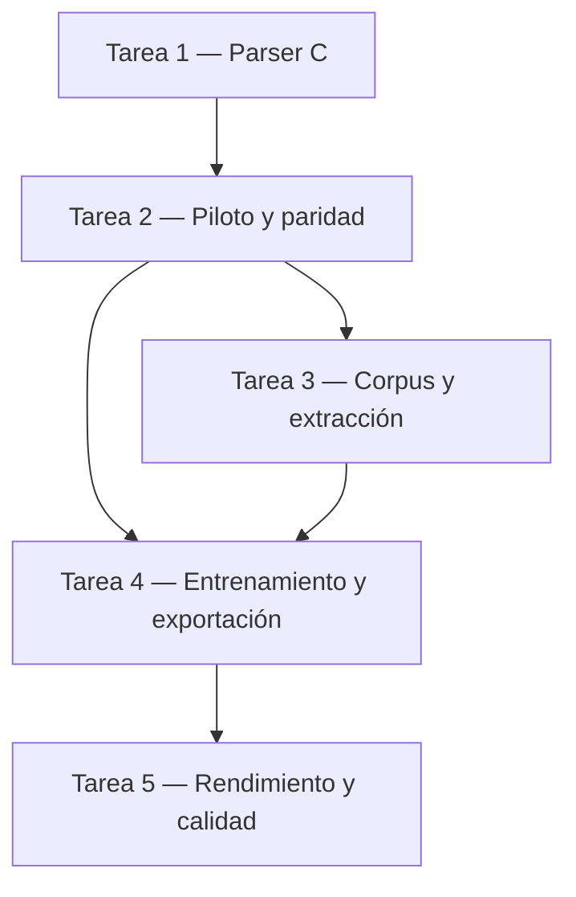

# Plan: Destilación del Code Predictor de Qwen3-TTS Base a tres capas

<project_context>
## Contexto del proyecto

AI Voice-InterConnector ejecuta Qwen3-TTS 0.6B Base localmente para síntesis y clonación de voz. El Talker produce `code0` y el Code Predictor (CP) de cinco capas predice los 15 códigos residuales de cada fotograma acústico. La tasa nominal es 12,5 fotogramas por segundo. Las voces `ryan` y `vivian` utilizan el modelo distinto CustomVoice; cambiar Base no optimiza sus CP.

El CP procesa 16 posiciones por fotograma; el motor puede fusionar las dos primeras en el prefill. Con tres capas, las evaluaciones por posición pasan de 80 a 48, una reducción del 40 % de esas evaluaciones, no necesariamente del tiempo total. La latencia y el RTF resultantes deben medirse. El informe `docs/reports/tts-cpu-optimization.md` documenta mediciones previas en Ryzen 7 5825U con cuatro hilos y `--quant-mixed`.

El corpus objetivo contiene 40 horas de habla activa de entrenamiento con VAD, exclusivamente en español e inglés: 20 horas por idioma. Se añaden objetivos de 2 horas activas para validación y 2 para prueba, con 1 hora por idioma en cada una. La disponibilidad debe comprobarse. El entrenamiento se intentará sin gasto mediante Kaggle y GPU T4 de 16 GB, sujeto a disponibilidad. La inferencia final se evaluará localmente con cuatro hilos y cuantización mixta.
</project_context>

## Tabla de contenidos

- [Contexto del proyecto](#contexto-del-proyecto)
- [Consideraciones fundamentales](#consideraciones-fundamentales)
- [Propósito del plan](#propósito-del-plan)
- [Objetivos del plan](#objetivos-del-plan)
- [Fase de ejecución](#fase-de-ejecución)
  - [Tarea 1 — Validar el parser y la carga dinámica](#tarea-1--validar-el-parser-y-la-carga-dinámica)
  - [Tarea 2 — Construir el piloto de paridad y viabilidad](#tarea-2--construir-el-piloto-de-paridad-y-viabilidad)
  - [Tarea 3 — Preparar el corpus y extraer los datos](#tarea-3--preparar-el-corpus-y-extraer-los-datos)
  - [Tarea 4 — Entrenar y exportar el estudiante](#tarea-4--entrenar-y-exportar-el-estudiante)
  - [Tarea 5 — Medir rendimiento y calidad](#tarea-5--medir-rendimiento-y-calidad)
- [Dependencias y orden de ejecución](#dependencias-y-orden-de-ejecución)
- [Fase de cierre](#fase-de-cierre)

<fundamental_considerations>
## Consideraciones fundamentales

- **Alcance:** se modifica el modelo Base; CustomVoice se comprueba como regresión independiente. No sustituir los pesos originales ni modificar el índice Git existente.
- **Datos:** objetivo de 20 h de habla activa en español y 20 h en inglés para entrenamiento; validación y prueba adicionales de 2 h activas cada una, con 1 h por idioma y separación por identidad y texto. La duración activa se calcula sumando intervalos de habla VAD sin solapamientos ni márgenes; registrar aparte duración original y audio retenido. Aplicar máximo de 15 minutos retenidos por identidad en todo el corpus, SNR estimada > 30 dB, sin ruido añadido ni audio restaurado o sometido a denoising. Los mínimos teóricos son 160 identidades para entrenamiento y 16 adicionales para validación y prueba; serán necesarias más si las pausas o la disponibilidad reducen el habla activa por persona. Las 44 h son objetivos, no datos verificados: detenerse si no se alcanzan y consultar antes de cambiar restricciones. La evaluación de control utiliza referencias Base autorizadas fuera del entrenamiento; `ryan` y `vivian` son regresiones independientes de CustomVoice, no una cuota de entrenamiento Base.
- **Fuentes:** [LibriTTS original](https://www.openslr.org/60/) y [VCTK](https://datashare.ed.ac.uk/handle/10283/3443) son candidatos para inglés, con licencias publicadas CC BY 4.0; `p315` carece de transcripción publicada. El [artículo de LibriTTS](https://arxiv.org/html/1904.02882v1) documenta 53,78 h y 247 locutores en `train-clean-100` antes de nuestros filtros; su umbral WADA de 20 dB no satisface por sí solo el requisito > 30 dB. [SLR61](https://www.openslr.org/61/), [SLR71](https://www.openslr.org/71/), [SLR72](https://www.openslr.org/72/) y [SLR73](https://www.openslr.org/73/) son candidatos para español publicados con CC BY-SA 4.0. Sus índices contienen respectivamente 44, 31, 33 y 38 prefijos candidatos; la [tarjeta de SLR71](https://huggingface.co/datasets/ylacombe/google-chilean-spanish) documenta 31 `speaker_id` y 7,15 h brutas. Verificar identidad y solapamiento entre fuentes sin intentar identificar personalmente a los participantes. MLS queda excluido; LibriTTS-R queda excluido por restauración Miipher. Las cifras publicadas no prueban horas útiles ni SNR; revisar obligaciones de uso y distribución antes de seleccionar una fuente.
- **Tratamiento acústico:** conservar frase y transcripción alineadas; no concatenar regiones discontinuas ni eliminar pausas internas. Usar VAD con histéresis, silencio mínimo de 200 ms y margen de 80 ms para identificar límites exteriores; validar los recortes. Medir sonoridad conforme a BS.1770 y normalizar a −23 LUFS sin clipping; antes de procesar el corpus definir tratamiento de mediciones inválidas y límite de ganancia. Muestrear y escuchar bordes VAD.
- **Referencias técnicas:** fijar el snapshot Base `5d83992436eae1d760afd27aff78a71d676296fc`, usado en `crates/avi-shared/src/paths.rs`, y como candidato de código Qwen el commit [`022e286b98fbec7e1e916cb940cdf532cd9f488e`](https://github.com/QwenLM/Qwen3-TTS/commit/022e286b98fbec7e1e916cb940cdf532cd9f488e), que corrige el desplazamiento de la máscara. Sus dependencias fijadas incluyen `transformers==4.57.3` y `accelerate==1.12.0`; validar y fijar las restantes. El tokenizer independiente tiene revisión `7dd38ad4e9bad454aae9cd937d0cd577604fe229`: comparar hashes con el tokenizer incluido en Base antes de intercambiarlos. [Qwen documenta](https://github.com/QwenLM/Qwen3-TTS/blob/022e286b98fbec7e1e916cb940cdf532cd9f488e/finetuning/README.md) fine-tuning de un solo locutor; la adaptación multispeaker requiere validación propia.
- **Arquitectura y pérdida:** usar la implementación y configuración oficiales como referencia, incluidas RMSNorm, normalización de Q/K, RoPE, GQA y 15 cabezas/embeddings. Inicializar las capas del estudiante desde `[0, 2, 4]`. Para cada KL, maestro y estudiante reciben el mismo estado Talker, `code0` y prefijo residual; los códigos del tokenizer no son logits del maestro. El paso paralelo, scheduled sampling, ponderación RVQ y jitter deben compararse con controles; no se presupone que mejoren calidad ni velocidad.
- **Recursos:** el conteo teórico, incluyendo tablas completas, es 110.108.416 parámetros para tres capas y 141.570.304 para cinco, bajo las dimensiones oficiales y proyección identidad. Verificar con el modelo real. La T4 Turing no tiene Tensor Cores BF16 nativos; probar FP16 con escalado y backend compatible en vez de asumir que el ejemplo oficial BF16/FlashAttention 2 funciona. Ninguna GPU gratuita está garantizada.
- **Cuota y persistencia:** [Kaggle](https://www.kaggle.com/docs/notebooks) ofrece GPU gratuita sujeta a disponibilidad; la documentación indexada indica 12 h para CPU/GPU y 9 h para TPU, pero debe comprobarse en la cuenta. Se emplean 9 h como presupuesto conservador por sesión. [Colab](https://research.google.com/colaboratory/faq.html#resource-limits) es una alternativa potencial con límites variables; [ZeroGPU](https://huggingface.co/docs/hub/spaces-zerogpu) tiene una cuota gratuita breve y no se considera base demostrada para la corrida completa. Prohibido incurrir en gasto sin autorización.
- **Compuerta de ejecución:** no procesar el corpus integral ni entrenar hasta disponer de procedimientos de extracción, paridad, reanudación y curación reproducibles y superar el piloto. No sustituir evidencia faltante por un valor por defecto; detenerse y comunicar la entrada o prueba que falta.
</fundamental_considerations>

<purpose_and_objectives>
## Propósito del plan

Determinar si reducir el CP de Qwen3-TTS 0.6B Base de cinco a tres capas permite síntesis y clonación de voz en CPU con RTF inferior a 1,0 sin pérdida de calidad inaceptable. La estrategia es comprobar primero la compatibilidad y viabilidad mediante un piloto, después destilar con un corpus objetivo de 40 horas y comparar el artefacto resultante con el maestro; un resultado negativo también constituye un resultado válido.

## Objetivos del plan

1. Corregir el parser C y comprobar carga segura de tres y cinco capas y rechazo de valores fuera de `1..QWEN_TTS_MAX_CP_LAYERS`.
2. Demostrar paridad del CP oficial, el estudiante de prueba y el motor; medir memoria, rendimiento y recuperación de checkpoints en el entorno realmente disponible.
3. Construir un inventario trazable con objetivo de 40 horas activas de entrenamiento y 2 horas activas adicionales para cada una de validación y prueba, repartidas equitativamente por idioma, con identidad, transcripción, licencia, duración, SNR y partición verificadas.
4. Entrenar y exportar un estudiante de tres capas en GPU gratuita únicamente si el piloto demuestra viabilidad y recuperación sin gasto.
5. Comparar maestro y estudiante con `--quant-mixed -j 4`: metas de CP < 40 ms/fotograma y mediana de RTF < 1,0; registrar también peticiones que no las cumplan.
6. Evaluar WER ≤ 0,05, similitud WavLM ≥ 0,98 y una prueba humana ciega de diez pares, comparando con el maestro; no aprobar si faltan mediciones o aprobación humana.
</purpose_and_objectives>

<execution_phase>
## Fase de ejecución

### Tarea 1 — Validar el parser y la carga dinámica

#### Propósito
El parser corta `code_predictor_config` en la primera llave de cierre y puede ignorar `num_hidden_layers`. Corregir el balanceo y validar los límites permite cargar tres capas sin acceder fuera de los arrays.

#### Objetivos

- Leer 3 y 5 con objetos anidados y cadenas con llaves; rechazar JSON truncado y capas fuera del rango.
- Superar las pruebas específicas y `cargo xtask build-engine --self-test`; este último por sí solo no verifica el parser.
- Ruta de reversión: conservar el ejecutable y los pesos originales; revertir exclusivamente los cambios propios si las pruebas fallan.

#### Acciones

1. **`vendor/qwen3-tts/qwen_tts.c`** — `json_match_brace` y `load_config`: devolver un error explícito ante llaves sin cerrar, adaptar sus llamadores de Talker, objetos anidados y decoder antes de operar con punteros y sustituir `strchr(cp_open, '}')` por balanceo correcto. Validar presencia, sintaxis entera completa y rango del número de capas antes de usarlo; liberar las asignaciones activas ante cada fallo. El helper actual devuelve el puntero al NUL si el objeto está truncado, no `NULL`.
2. **`vendor/qwen3-tts/qwen_tts.h`** — `QWEN_TTS_MAX_CP_LAYERS` y arrays: comprobar el límite de cinco y que no haya acceso fuera de rango.
3. **`vendor/qwen3-tts/qwen_tts_code_predictor.c` y `vendor/qwen3-tts/qwen_tts.c`** — carga, ejecución y liberación: verificar recorridos y limpieza para 3 y 5 capas, también ante fallo parcial.
4. **`vendor/qwen3-tts/qwen_tts.c` y pruebas específicas** — compilar un programa de prueba unitaria aislado contra `qwen_tts.c` con GCC o Clang en modo ASan (`-fsanitize=address,undefined -g -O0 -Ivendor/qwen3-tts`); probar casos válidos (3 y 5 capas, claves en distinto orden, espacios, saltos de línea, objetos anidados arbitrarios anteriores a `num_hidden_layers`, llaves dentro de cadenas con comillas escapadas) y casos inválidos (JSON truncado en distintos niveles de profundidad, valor de `num_hidden_layers` igual a 0, 6, negativo, no numérico, desbordamiento de entero, y clave ausente). Verificar que ante cualquier error `load_config` devuelva `-1`, libere todos los buffers asignados sin fugas de memoria y no continúe con un valor por defecto que oculte la corrupción.
5. **`cargo xtask build-engine --self-test`** — desde la raíz: compilar y ejecutar el self-test después de las pruebas específicas. Si una prueba falla, detener la ejecución; el self-test por sí solo no acredita el parser ni la seguridad de memoria.

### Tarea 2 — Construir el piloto de paridad y viabilidad

#### Propósito
La equivalencia arquitectónica, la extracción de estados y el costo no se conocen. Un piloto pequeño debe demostrar estos contratos antes de invertir en el corpus y el entrenamiento completos.

#### Objetivos

- Verificar alineamiento y paridad de logits en 5 capas, en forward paralelo/secuencial y entre PyTorch y C para artefactos de 5 y 3 capas.
- Medir GPU, memoria, rendimiento y recuperación desde una sesión nueva sin gasto.
- Ruta de reversión: usar copias y artefactos de prueba aislados, sin reemplazar los modelos originales.

#### Acciones

1. **`Qwen/Qwen3-TTS-12Hz-0.6B-Base`** — snapshot fijado: clonar la revisión `5d83992436eae1d760afd27aff78a71d676296fc`, registrar los hashes SHA-256 de `model.safetensors`, `config.json` y `speech_tokenizer/model.safetensors`; inventariar todas las claves, formas y dtypes de los tensores del Talker y CP; seleccionar diez muestras de audio WAV (cinco en español y cinco en inglés) con locutores identificados, audio a 24 kHz, transcripción y referencia de voz autorizada.
2. **`Qwen3-TTS/finetuning/prepare_data.py` y `sft_12hz.py`** — adaptar la obtención de códigos y estados condicionados por texto, voz y contexto; comprobar que `codec_mask[:, :-1]` y `codec_ids[codec_mask]` seleccionan fotogramas correspondientes, además de formas y valores finitos. La implementación oficial lee `language` en `dataset.py` sin incorporarlo al `collate` examinado: validar expresamente el prompt multilingüe, las referencias de longitudes distintas y la adaptación multispeaker.
3. **`Qwen3-TTS` y `vendor/qwen3-tts/qwen_tts_code_predictor.c`** — comparar logits posicionales: alimentar a PyTorch y a la función de inferencia C las mismas entradas exactas (`talker_hidden`, `code0` y prefijos residuales de referencia), comparar los logits de salida de las 15 cabezas en FP32 sin cuantización exigiendo $\text{rtol} \le 10^{-4}, \text{atol} \le 10^{-4}$ para el forward secuencial vs paralelo de referencia, y $\text{rtol} \le 10^{-3}, \text{atol} \le 10^{-3}$ para C vs PyTorch; construir un modelo de 3 capas sin entrenar copiando capas `[0, 2, 4]` y validar que C lo ejecute con 3 capas produciendo salidas finitas idénticas a PyTorch bajo las mismas tolerancias.
4. **`Kaggle Notebooks`** — en un notebook de Kaggle con GPU T4 x1 (16 GB VRAM) y entorno PyTorch 2.x, registrar `nvidia-smi`, versión de CUDA, cuota semanal restante y espacio en disco; ejecutar un micro-benchmark de entrenamiento con 20 lotes de calentamiento y 100 lotes medidos con `torch.cuda.synchronize()`, evaluando tamaños de lote 32, 64 y 128 en AMP FP16; medir memoria VRAM pico asignada/reservada y tiempo en milisegundos por lote para teacher forcing paralelo y scheduled sampling; calcular el tiempo total proyectado para 40 horas a 8 épocas con el lote máximo estable.
5. **`Kaggle datasets API`** — verificar en una segunda sesión la recuperación de un checkpoint completo: pesos, optimizador, scheduler, AMP, RNG de Python, NumPy, PyTorch y CUDA, estado del sampler, posición del dataset, configuración y hashes. Guardar atómicamente, publicar en almacenamiento privado permitido y comprobar que se incluyan los archivos de subdirectorios: el modo predeterminado de la API los omite. Esperar la finalización, descargar en sesión nueva y comparar hashes. Contrastar además una corrida breve continua con otra interrumpida y reanudada: siguiente lote, learning rate, pérdida y parámetros deben coincidir dentro de la tolerancia definida. `/kaggle/working` por sí solo no demuestra persistencia. Registrar costos, permisos y cuota sin exponer credenciales; ante fallo detenerse.
6. **Compuerta** — registrar para cada prueba la revisión, entrada, comando, salida y veredicto; detenerse si falta paridad, alineamiento, GPU apta, capacidad de reanudación o evidencia. La aprobación exige un lote real con salida finita, comparación de logits de 3 y 5 capas y reanudación en sesión nueva; una comprobación estática de archivos no sustituye esas pruebas.

#### Contrato de datos del piloto

- **Entrada:** diez registros de frase con `sample_id`, `speaker_id`, idioma, texto, audio, referencia autorizada de la misma identidad y partición. Registrar hashes y mantener separadas las identidades y los textos usados para prueba. La referencia de voz no debe proceder de otra partición.
- **Salida por frase:** `talker_hidden` con un vector por fotograma, `audio_codes` con 16 códigos por fotograma, máscara y longitud válidas, más los identificadores y hashes de entrada. Las dimensiones exactas y el desplazamiento se comprueban contra el snapshot y la implementación oficiales; no inferir correspondencia solo porque coincidan las longitudes.
- **Validación:** comprobar `len(talker_hidden) == len(audio_codes) == suma(mask)`, códigos enteros dentro del rango admitido por el tokenizer, estados y logits finitos y correspondencia de cada fotograma con `codec_mask[:, :-1]`. Conservar por separado los límites de cada frase para que el muestreo y los shards no mezclen contextos.
- **Paridad:** para cada posición residual comparar distribuciones de la misma cabeza con idénticos estado, `code0`, prefijo, pesos y máscara. Reportar error máximo absoluto y relativo por cabeza, tolerancia y número de fallos; `argmax` coincidente por sí solo no acredita paridad. Comparar primero sin cuantización y registrar por separado cualquier diferencia derivada de `--quant-mixed`.

### Tarea 3 — Preparar el corpus y extraer los datos

#### Propósito
La disponibilidad real de audio limpio, transcrito y diverso no se deduce de las horas publicadas. Un inventario verificable y particionado permite medir qué datos cumplen los requisitos antes de generar tensores.

#### Objetivos

- Obtener 20 h activas por idioma para entrenamiento y 1 h activa por idioma para cada una de validación y prueba; no confundir duración retenida con duración de habla activa.
- Mantener separación por locutor y texto entre entrenamiento, validación y prueba; no usar prueba para seleccionar hiperparámetros.
- Ruta de reversión: conservar fuentes originales y escribir datos procesados en almacenamiento aislado.

#### Acciones

1. **Fuentes enumeradas en consideraciones fundamentales** — verificar licencia, identidad por locutor, duración por categoría, transcripción, SNR y duplicados; determinar los aportes por fuente tras comprobar horas aceptables y cumplir las cuotas ya fijadas por idioma y partición. La evaluación de control queda fuera del entrenamiento y no asigna dos horas a presets.
2. **Inventario del corpus** — crear el inventario de candidatos y actualizarlo tras la curación: registrar para cada muestra identificador y hash, fuente y licencia, identidad y evidencia de identidad, idioma, texto, partición, duración original, retenida y de habla activa, SNR y su incertidumbre, intervalos VAD, LUFS, ganancia, pico y motivo de rechazo. Calcular habla activa sin márgenes como unión de intervalos VAD sin solapamientos; validar duplicados y techo global de 900 segundos retenidos por identidad, seleccionando frases completas sin sobrepasarlo. No deducir que identificadores iguales o distintos entre corpus equivalen a personas iguales o distintas sin evidencia; excluir asignaciones ambiguas que impidan verificar la separación. Comprobar cada cuota después de la curación y antes de aprobar el inventario; ante déficit, detenerse e informar horas e identidades faltantes.
3. **`silero-vad` y audio original** — evaluar como configuración inicial, no validada, VAD a 16 kHz con entrada 0,5, salida 0,35 y silencio mínimo 200 ms. Registrar por separado intervalos sin margen para contabilizar habla y límites exteriores con margen de 80 ms para recortar; la histéresis y el silencio mínimo son aproximaciones y pueden incluir pausas breves. Trasladar tiempos al audio de 24 kHz y conservar el tramo continuo entre primer inicio y último final. No concatenar intervalos; verificar bordes mediante escucha. Estimar SNR sobre el original con regiones de habla y ruido y contrastar con un estimador sin referencia; si no hay silencio suficiente, el ruido varía o los métodos discrepan, clasificar como indeterminado y revisar o rechazar. Aceptar solo muestras con estimación > 30 dB y método calibrado; la estimación no demuestra SNR verdadero.
4. **Medición BS.1770 y audio retenido** — medir LUFS integrados y aplicar ganancia constante para alcanzar −23 LUFS; rechazar mediciones no finitas, ausencia de habla, clipping y ganancias superiores al límite que se establezca y valide en el piloto. No usar limitación dinámica como sustituto silencioso. Registrar mediciones y ganancia y conservar los originales.
5. **Pipeline validado en la tarea 2** — solo tras aprobar el inventario y las cuotas, extraer estados y códigos de las muestras curadas sin unir intervalos discontinuos, preservar alineamiento y guardar shards con metadatos, incluyendo el último shard parcial. Verificar sumas, rangos, dtype y dimensiones. A 12,5 Hz, 40 h activas equivalen nominalmente a 1,8 millones de fotogramas de habla; los fotogramas reales extraídos incluyen pausas retenidas y dependen de límites y padding.

#### Comprobación de cuotas

Calcular para cada identidad la suma de segundos retenidos de todas sus muestras aceptadas, incluidas las referencias contabilizadas en el corpus, y rechazar cualquier selección que supere 900 s. Sumar por separado los segundos activos de las muestras aceptadas de cada combinación de idioma y partición; las seis celdas deben alcanzar sus objetivos de 20 h ES/EN en entrenamiento y 1 h ES/EN en cada partición adicional. Mantener frases completas y registrar cualquier exceso por la última frase sin sobrepasar el límite por identidad. Validar que ninguna identidad ni texto normalizado aparezca en más de una partición y que las referencias respeten la misma separación. Un déficit, una identidad ambigua o una licencia no verificada bloquean la aprobación del inventario.

### Tarea 4 — Entrenar y exportar el estudiante

#### Propósito
El estudiante debe conservar la función del maestro con menos capas. La destilación y exportación verificadas permiten evaluar el compromiso real entre calidad y latencia.

#### Objetivos

- Entrenar con el presupuesto gratuito comprobado y checkpoints recuperables; no afirmar una duración prevista como resultado.
- Exportar un snapshot Base independiente con tres capas y comprobar claves, formas, dtypes y configuración.
- Ruta de reversión: no alterar el snapshot maestro ni los archivos de producción; mantener el artefacto de prueba separado.

#### Acciones

1. **Pipeline validado de la tarea 2** — inicializar el estudiante de 3 capas copiando estrictamente los tensores del maestro: capa 0 desde `layers.0`, capa 1 desde `layers.2`, y capa 2 desde `layers.4`; copiar intactos la norma final `model.norm.weight`, las 15 tablas `input_embeddings.0..14.weight` y las 15 proyecciones `lm_heads.0..14.weight`; congelar Talker, speaker encoder y decoder, marcando como entrenables exclusivamente los parámetros del CP.
2. **Datos de la tarea 3** — entrenar con optimizador AdamW ($\text{lr} = 5 \times 10^{-5}$, $\beta_1=0,9$, $\beta_2=0,999$, `weight_decay = 0.01`), planificador coseno con 1 época de warmup, batch size determinado en el piloto y AMP FP16 con `GradScaler`; calcular la pérdida como:
   $$\mathcal{L} = \frac{1}{15}\sum_{i=1}^{15}\mathcal{L}_{\text{CE}}(y_i, \hat{y}_i) + 0,5 \cdot \frac{T^2}{15}\sum_{i=1}^{15} D_{\text{KL}}\left(p_{\text{maestro},i}^{(T)} \parallel p_{\text{estudiante},i}^{(T)}\right)$$
   con temperatura de destilación $T=2,0$, sobre posiciones y fotogramas válidos de `codec_mask[:, :-1]`, con el maestro congelado y evaluando la KL en FP32 sobre el mismo prefijo residual; comparar teacher forcing paralelo contra scheduled sampling como variante experimental; desescalar gradientes y recortar norma en 1,0; detenerse ante pérdidas no finitas o divergencia; seleccionar el mejor checkpoint mediante la pérdida en el conjunto de validación.
3. **`config.json` y `model.safetensors`** — construir el artefacto exportado a partir del snapshot Base fijado: sustituir en `model.safetensors` los tensores entrenados del CP con nombres `talker.code_predictor.model.layers.{0,1,2}.*`, `talker.code_predictor.model.norm.weight`, `talker.code_predictor.input_embeddings.{0..14}.weight` y `talker.code_predictor.lm_heads.{0..14}.weight`; eliminar las capas 3 y 4 del maestro; actualizar `config.json` fijando `talker_config.code_predictor_config.num_hidden_layers = 3` y `talker_config.code_predictor_config.layer_types = ["full_attention", "full_attention", "full_attention"]`; verificar que `tts_model_type` permanezca como `"base"` y que todos los archivos del snapshot se copien íntegros a una carpeta de prueba aislada sin tocar los pesos originales.

### Tarea 5 — Medir rendimiento y calidad

#### Propósito
La reducción de capas no garantiza tiempo real ni fidelidad. Una comparación pareada y reproducible permite decidir si el modelo cumple las metas del producto.

#### Objetivos

- Medir CP y RTF en el equipo de referencia con modelos y solicitudes equivalentes; RTF = tiempo de síntesis / duración del audio, en las mismas unidades.
- Evaluar WER, WavLM y escucha humana sin confundir los presets CustomVoice con el modelo Base.

#### Acciones

1. **`vendor/qwen3-tts/qwen_tts.exe` y daemon del proyecto** — levantar el motor en modo servidor local (`.\vendor\qwen3-tts\qwen_tts.exe -d <directorio_modelo> --quant-mixed -j 4 --serve 63250`); enviar diez solicitudes HTTP POST idénticas para maestro y estudiante con diez textos de prueba fijados (cinco en español y cinco en inglés), semilla fija `42`, temperatura `0,0` y voz `default`; para cada solicitud registrar `prefill_ms`, tiempo medio por fotograma del CP (`cp/f` en ms), tiempo total de síntesis (`wall_ms`) y duración exacta del audio emitido ($\text{dur\_sec} = \text{samples} / 24000$); calcular el factor de tiempo real por petición como $\text{RTF} = \text{wall\_ms} / (1000 \times \text{dur\_sec})$; verificar que la mediana del CP cumpla $\text{cp/f} < 40\text{ ms}$ y la mediana del RTF sea $< 1,0$.
2. **`nvidia/parakeet-tdt-0.6b-v3`** — remuestrear los diez audios generados a 16 kHz y transcribir con Parakeet TDT v3; normalizar tanto el texto de referencia como la transcripción eliminando puntuación (`[, . ! ? ¿ ¡ - ; : " ' ( )]`), convirtiendo a minúsculas y normalizando espacios; calcular $\text{WER} = (S + D + I) / N$ por idioma y agregado; comprobar la meta de $\text{WER} \le 0,05$ e inspeccionar manualmente que no existan omisiones de palabras ni cortes al final de frase.
3. **`microsoft/wavlm-base-plus-sv`** — remuestrear la referencia de voz autorizada y el audio sintetizado a 16 kHz; extraer los vectores de identidad de 512 dimensiones con `WavLMForXVector`; normalizar en norma $L_2$ ($\hat{\mathbf{e}} = \mathbf{e} / \|\mathbf{e}\|_2$); calcular la similitud coseno $S_{\text{cos}} = \hat{\mathbf{e}}_{\text{ref}} \cdot \hat{\mathbf{e}}_{\text{syn}}$; exigir una media de $S_{\text{cos}} \ge 0,98$ y verificar que ninguna muestra individual caiga por debajo de $0,90$.
4. **Escucha ciega humana** — generar los diez pares pareados con maestro y estudiante bajo la misma semilla y parámetros; asignar aleatoriamente las etiquetas A y B para cada par y guardar la clave encriptada/sellada; entregar a los evaluadores un formulario con tres opciones por par (`[ ] Prefiero A`, `[ ] Prefiero B`, `[ ] Indistinguibles`) y casillas de reporte de defectos acústicos graves (zumbido, clipping, palabras cortadas); regla de aprobación: el estudiante se aprueba únicamente si obtiene al menos un 70 % de veredictos no inferiores (preferencia por estudiante o indistinguible) y cero defectos graves reportados; evaluar de forma separada `ryan` y `vivian` como pruebas de no-regresión de CustomVoice.
</execution_phase>

<dependency_graph>
## Dependencias y orden de ejecución

La numeración representa el orden recomendado. No iniciar la producción integral ni el entrenamiento mientras el piloto, sus scripts y la composición del corpus estén sin resolver.
</dependency_graph>

<closure_phase>
## Fase de cierre

Al concluir o detener la ejecución, presentar en español el proceso seguido, las desviaciones y sus motivos, las compuertas aprobadas y fallidas, los costos reales, las métricas comparativas, los límites de la evidencia y el resultado de la escucha humana. Si no se cumple alguna meta o falta evidencia, no declarar el modelo listo para adopción.
</closure_phase>
