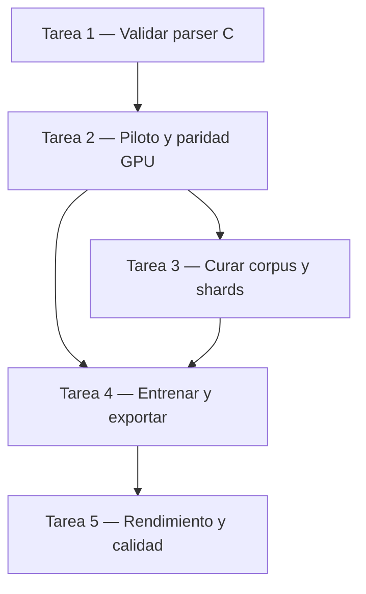

# Plan: Destilación del Code Predictor de Qwen3-TTS Base a tres capas

## Contexto del proyecto

AI Voice-InterConnector ejecuta Qwen3-TTS 0.6B Base localmente para síntesis y clonación de voz cero-shot en la CPU del usuario. El pipeline acústico se compone de tres módulos: el modelo principal (Talker, 28 capas Transformer causales) que predice el primer código acústico (`code0`), el predictor de códigos residuales (Code Predictor o CP, 5 capas Transformer) que predice secuencialmente los 15 códigos residuales (`code1` a `code15`) de cada fotograma acústico a una tasa nominal de 12,5 Hz (80 ms por fotograma), y el decodificador de voz (Speech Decoder, ConvNet causal) que sintetiza la forma de onda a 24 kHz. Las voces preestablecidas `ryan` y `vivian` utilizan el modelo independiente CustomVoice (`Qwen3-TTS-12Hz-0.6B-CustomVoice`), por lo que las optimizaciones en Base no alteran su comportamiento ni sus pesos.

En la configuración actual de inferencia con cuantización mixta (`--quant-mixed -j 4`), el Talker opera en INT4 y el CP en INT8, ambos con producto escalar entero en los kernels. En el procesador de referencia (AMD Ryzen 7 5825U, documentado en `docs/reports/tts-cpu-optimization.md`) el factor de tiempo real (RTF) mediano ya es de 0,76 con el equipo libre y de 0,88 con cuatro núcleos ocupados por otros procesos, sin reentrenar el modelo. Con dos hilos saturando el ancho de banda de memoria sigue en 1,47, porque el CP queda limitado por los bytes de pesos que lee en cada fotograma (85,8 ms/fotograma frente a 41,3 sin carga). El CP realiza 15 evaluaciones secuenciales por fotograma acústico (15 pasadas × 5 capas = 75 evaluaciones de capa Transformer por fotograma). Reducir la profundidad del CP de 5 a 3 capas disminuye las evaluaciones por fotograma de 75 a 45 (reducción del 40 % en evaluaciones del módulo CP) y los pesos leídos por fotograma en la misma proporción, de modo que ya no es condición necesaria para el RTF < 1,0 con carga de CPU, sino el margen adicional y la vía para reducir el tráfico de memoria que limita el caso que sigue por encima de 1.

El entrenamiento se proyecta a costo cero sobre GPU gratuita (NVIDIA T4 de 16 GB en Kaggle Notebooks o Google Colab), empleando un corpus curado de 40 horas netas de habla activa para entrenamiento y 4 horas adicionales para validación y prueba, distribuido equitativamente entre español e inglés (50 % ES / 50 % EN).

## Tabla de contenidos

- Contexto del proyecto
- Consideraciones fundamentales para el razonamiento y diseño del plan
- Propósito del plan
- Objetivos del plan
- Fase de ejecución
  - Tarea 1 — Validar el parser JSON y la carga dinámica en `vendor/qwen3-tts/qwen_tts.c`
  - Tarea 2 — Construir el prototipo de extracción con token de idioma y paridad numérica en GPU
  - Tarea 3 — Curar el corpus bilingüe y extraer shards de tensores alineados
  - Tarea 4 — Entrenar y exportar el modelo estudiante de tres capas en `models/qwen3-tts-0.6b-3layers/`
  - Tarea 5 — Evaluar rendimiento en CPU, inteligibilidad fonética y fidelidad acústica pareada
- Dependencias y orden de ejecución
- Fase de cierre

## Consideraciones fundamentales para el razonamiento y diseño del plan

- **Madurez y dependientes:** El proyecto se encuentra en desarrollo activo con releases estables distribuidos a usuarios finales. El modelo `Qwen3-TTS-12Hz-0.6B-Base` es consumido exclusivamente por el subsistema de clonación de voz cero-shot y la voz sintetizada de fábrica (`default`), mientras que las voces preestablecidas `ryan` y `vivian` dependen de `Qwen3-TTS-12Hz-0.6B-CustomVoice`. La destilación modifica exclusivamente los tensores del Code Predictor en el snapshot del modelo Base, manteniendo intactos los contratos públicos de CLI (`ai-voice-interconnector synthesize` y `voice clone`), el daemon HTTP (`/synthesize`, `/dub`) y la compatibilidad con CustomVoice.
- **Estado canónico y sincronía:** Tras la ejecución, deben quedar perfectamente sincronizados: (1) el parser y estructuras del motor C en `vendor/qwen3-tts/qwen_tts.c` y `vendor/qwen3-tts/qwen_tts.h`, (2) la configuración `config.json` declarando 3 capas en el Code Predictor (`talker_config.code_predictor_config.num_hidden_layers = 3`), (3) los pesos serializados en `model.safetensors`, y (4) la resolución de rutas en `crates/avi-tts` y `crates/avi-shared`. Los artefactos intermedios generados durante la curación y entrenamiento (archivos `.pt` de shards, manifests brutos y checkpoints no seleccionados) se aíslan fuera del árbol Git en almacenamiento temporal y en Kaggle Datasets API.
- **Condicionamiento explícito del idioma (`language_id`):** En el pipeline de fine-tuning original de Qwen3-TTS (`finetuning/dataset.py`), existe un defecto donde el token de idioma es ignorado al construir los prompts de entrenamiento, provocando interferencia fonética entre idiomas en corpus multilingües. Es requisito mandatorio inyectar explícitamente el token de idioma correspondiente (`language_id` para Spanish o English) dentro de la secuencia de prefijo del Talker (`[THINK, THINK_BOS, language_id, THINK_EOS, speaker, PAD, BOS]`) durante la extracción de estados ocultos `talker_hidden`, replicando con exactitud la construcción de prompts del motor C en `vendor/qwen3-tts/qwen_tts.c`.
- **Dinámica de error en el Code Predictor y monitoreo por tramos:** El error acumulativo del CP se concentra en las 15 pasadas secuenciales del Transformer compartido y no en las cabezas lineales `lm_heads`. Los codebooks iniciales (`code1` a `code5`) son tolerantes, pero los codebooks tardíos (`code11` a `code15`) sufren mayor riesgo de divergencia autoregresiva. El plan prescribe supervisar la pérdida y la concordancia argmax desglosada por tramos (`c1-c5`, `c6-c10`, `c11-c15`) en cada época de validación para prevenir el colapso de códigos residuales finos.
- **Cuotas cuantitativas del corpus:** El objetivo formal es de 40 horas netas de habla activa para entrenamiento (20 h en español y 20 h en inglés), más 2 horas de habla activa para validación (1 h ES / 1 h EN) y 2 horas para prueba (1 h ES / 1 h EN). La duración de habla activa se mide sumando estrictamente los intervalos con probabilidad de voz positiva detectados por VAD, sin solapamientos ni márgenes. Se impone un techo estricto de máximo 15 minutos (900 segundos) de audio retenido por identidad en todo el corpus, requiriendo un mínimo matemático de 160 identidades para entrenamiento y 16 adicionales para validación y prueba.
- **Fuentes autorizadas y restricciones:** Fuentes candidatas en inglés: [LibriTTS original (SLR60)](https://www.openslr.org/60/) (licencia CC BY 4.0; `train-clean-100` aporta 53,78 h brutas en 247 hablantes bajo filtro original WADA ≥ 20 dB) y [VCTK 0.92](https://datashare.ed.ac.uk/handle/10283/3443) (licencia CC BY 4.0, 109 locutores con texto; la muestra `p315` carece de transcripción publicada y se excluye de la ruta supervisada). Fuentes candidatas en español: [SLR61](https://www.openslr.org/61/), [SLR71](https://www.openslr.org/71/), [SLR72](https://www.openslr.org/72/) y [SLR73](https://www.openslr.org/73/) (licencia CC BY-SA 4.0; 31 a 44 identidades documentadas por dialecto). Quedan expresamente excluidos LibriTTS-R (por utilizar restauración sintética Miipher) y Multilingual LibriSpeech (MLS, por estar limitado a 16 kHz de origen). No se admite audio con ruido artificial añadido ni filtrado por *denoiser* destructivo.
- **Tratamiento acústico y VAD:** Conservar la integridad frase-transcripción. Silencios exteriores superiores a 200 ms se recortan mediante Silero VAD a 16 kHz con márgenes de seguridad de 80 ms, manteniendo las pausas internas intactas dentro de un único tramo continuo por frase sin concatenar fragmentos discontinuos. Se exige SNR estimada > 30 dB sobre el audio original mediante análisis WADA-SNR contrastado con método de energía en pausas. La sonoridad se normaliza a −23 LUFS integrado según norma ITU-R BS.1770-4 con ganancia fija por archivo (rechazando mediciones con ganancia requerida > +12 dB o clipping > −0,5 dBFS).
- **Referencias técnicas fijadas:** Snapshot oficial del modelo Base `5d83992436eae1d760afd27aff78a71d676296fc` (`crates/avi-shared/src/paths.rs`). Repositorio de código Qwen3-TTS fijado en commit [`022e286b98fbec7e1e916cb940cdf532cd9f488e`](https://github.com/QwenLM/Qwen3-TTS/commit/022e286b98fbec7e1e916cb940cdf532cd9f488e) con `transformers==4.57.3` y `accelerate==1.12.0`. Tokenizer acústico de 12 Hz fijado en revisión `7dd38ad4e9bad454aae9cd937d0cd577604fe229`.
- **Arquitectura y conteo de parámetros del CP:** Dimensiones oficiales: `hidden_size=1024`, `intermediate_size=3072`, `num_attention_heads=16`, `num_key_value_heads=8` (GQA 2:1), `head_dim=128`, RMSNorm con $\epsilon=10^{-6}$, QK-norm y NeoX RoPE. Con 15 capas de embedding de entrada (3072x1024) y 15 cabezas LM (1024x2048), el CP de 5 capas contiene 141.570.304 parámetros y el estudiante de 3 capas contiene 110.108.416 parámetros (reducción de 31.461.888 parámetros correspondientes a 2 capas Transformer completas).
- **Entorno de entrenamiento y compatibilidad GPU:** La GPU NVIDIA T4 (arquitectura Turing) no dispone de aceleración nativa BF16 en Tensor Cores; el entrenamiento se configura en AMP FP16 con `torch.cuda.amp.autocast(dtype=torch.float16)` y `GradScaler`. Se adopta un presupuesto conservador de 9 horas continuas por sesión en Kaggle Notebooks, exigiendo persistencia atómica de checkpoints en Kaggle Datasets API y demostración de reanudación exacta en sesión limpia antes de iniciar el entrenamiento a gran escala.

## Propósito del plan

La síntesis y clonación de voz cero-shot en CPU con Qwen3-TTS 0.6B Base bajo cuantización mixta alcanza un RTF mediano de 0,76 en 4 hilos con el equipo libre y de 0,88 con cuatro núcleos ocupados, pero con el ancho de banda de memoria saturado sube a 1,47 y deja de servir para streaming interactivo en tiempo real (RTF < 1,0); además, el margen frente a 1,0 bajo carga de CPU es estrecho. El Code Predictor de 5 capas ejecuta 15 evaluaciones Transformer secuenciales por cada fotograma acústico de 80 ms (75 evaluaciones de capa por fotograma), concentrando una fracción crítica de la latencia total del pipeline acústico.

Se propone investigar, prototipar y ejecutar la destilación del Code Predictor de 5 a 3 capas (reducción de 75 a 45 evaluaciones de capa Transformer, 40 % de disminución en el módulo CP) supervisada por el modelo maestro sobre un corpus bilingüe curado de 40 horas netas de habla activa en español e inglés a costo cero en GPU gratuita. Esta optimización busca ampliar el margen de tiempo real y reducir el tráfico de memoria por fotograma: latencia del CP por debajo de 40 ms por fotograma y mediana global de RTF < 1,0 en inferencia local con cuatro hilos (`--quant-mixed -j 4`), preservando la inteligibilidad fonética ($\text{WER} \le 0,05$ con Parakeet TDT v3), la fidelidad acústica del hablante ($\text{WavLM} \ge 0,98$) y la aprobación explícita en escucha ciega humana pareada.

## Objetivos del plan

1. Corregir y validar el parser JSON del motor C (`vendor/qwen3-tts/qwen_tts.c`) para cargar de forma segura configuraciones dinámicas de 3 y 5 capas del Code Predictor sin fugas de memoria ni lecturas fuera de rango.
2. Ejecutar un piloto experimental de paridad numérica FP32 ($\text{rtol} \le 10^{-3}$ entre PyTorch y C) sobre 10 muestras de audio autorizadas, validando la extracción condicionada por idioma, el consumo de VRAM en GPU T4 y la reanudación exacta de checkpoints.
3. Construir un inventario auditado y curar 40 horas netas de habla activa para entrenamiento (20 h ES / 20 h EN) y 4 horas adicionales para validación y prueba (2 h ES / 2 h EN) bajo criterios estrictos de SNR > 30 dB, BS.1770 a −23 LUFS y techo de 15 min por identidad.
4. Entrenar el estudiante de 3 capas en GPU T4 mediante destilación supervisada (CE + KL con $T=2,0$) con monitoreo de concordancia por tramos de codebooks y exportar un snapshot Base compatible en formato `safetensors` y `config.json`.
5. Evaluar en hardware CPU local con `--quant-mixed -j 4` la reducción de latencia del CP ($< 40\text{ ms/fotograma}$), la mediana de factor de tiempo real ($\text{RTF} < 1,0$), la inteligibilidad ($\text{WER} \le 0,05$), la similitud de voz ($\text{WavLM} \ge 0,98$) y la aprobación en prueba ciega humana pareada.

## Fase de ejecución

### Tarea 1 — Validar el parser JSON y la carga dinámica en `vendor/qwen3-tts/qwen_tts.c`

#### Propósito

El parser JSON del motor C en `vendor/qwen3-tts/qwen_tts.c` busca la primera llave de cierre `}` para aislar `code_predictor_config`, provocando lecturas truncadas si existen objetos anidados previos y recurriendo silenciosamente al valor por defecto de 5 capas. Se requiere sustituir dicha lógica por balanceo sintáctico completo y validación estricta de límites para permitir la carga segura de modelos con 3 capas del Code Predictor.

#### Objetivos

- Leer correctamente `num_hidden_layers` (valores 3 y 5) en presencia de objetos JSON anidados, espacios y caracteres escapados en cadenas.
- Rechazar configuraciones con capas fuera del rango `1..5` o JSON truncado con retorno de error explícito `-1` y liberación total de memoria.
- Superar las pruebas unitarias aisladas en modo ASan y el comando `cargo xtask build-engine --self-test`.
- Ruta de reversión: restaurar `vendor/qwen3-tts/qwen_tts.c` y `vendor/qwen3-tts/qwen_tts.h` al estado previo mediante `git checkout` si falla la suite de pruebas.

#### Acciones

1. **`vendor/qwen3-tts/qwen_tts.c`** — función `json_match_brace`: modificar la función para devolver `NULL` (en lugar del puntero al byte terminador `\0`) cuando la profundidad de llaves no retorne a 0; actualizar todos sus llamadores (`talker_config`, objetos anidados y `decoder_config`) para verificar `NULL` y retornar `-1` con liberación de buffers asignados ante JSON malformado o truncado.
2. **`vendor/qwen3-tts/qwen_tts.c`** — función `load_config`: sustituir la búsqueda de llave simple `strchr(cp_open, '}')` por `json_match_brace(cp_open + 1, 1)` al aislar `code_predictor_config`; validar que `cp_num_layers` sea un entero positivo en el rango estricto `1 <= cp_num_layers <= QWEN_TTS_MAX_CP_LAYERS` (5); si el valor es inválido o ausente, rechazar la carga retornando `-1` sin adoptar valores por defecto silenciosos.
3. **`vendor/qwen3-tts/qwen_tts.h`** — definición `QWEN_TTS_MAX_CP_LAYERS`: comprobar que la constante esté fijada en 5 y que las estructuras de datos `qwen_cp_layer_t cp_layers[5]` en `qwen_tts_ctx_t` protejan contra accesos fuera de rango para cualquier valor $N \le 5$.
4. **`vendor/qwen3-tts/qwen_tts_code_predictor.c`** — funciones `qwen_cp_load_weights`, `qwen_cp_forward` y `qwen_cp_free`: verificar que los bucles de carga, inferencia y liberación iteren exactamente sobre `config->cp_num_layers` (tanto para 3 como para 5 capas), sin dejar tensores huérfanos ni desreferenciar punteros nulos.
5. **`vendor/qwen3-tts/qwen_tts.c`** — suite de pruebas unitarias del parser: compilar y ejecutar un binario de prueba dedicado con GCC/Clang y AddressSanitizer (`-fsanitize=address,undefined -g -O0 -Ivendor/qwen3-tts`); validar casos válidos (3 y 5 capas con objetos anidados) y casos de fallo (JSON truncado, `num_hidden_layers` = 0, 6, negativo, texto no numérico, desbordamiento entero), comprobando retorno `-1` y ausencia de fugas de memoria.
6. **`vendor/qwen3-tts/Makefile`** — objetivo de prueba: ejecutar `cargo xtask build-engine --self-test` desde la raíz del workspace para confirmar que la compilación y los tests de regresión del motor C pasen limpiamente.

### Tarea 2 — Construir el prototipo de extracción con token de idioma y paridad numérica en GPU

#### Propósito

La extracción de estados ocultos del Talker condicionados por texto y voz, la paridad numérica entre implementaciones (PyTorch vs C) y el presupuesto de tiempo/memoria en GPU T4 no han sido medidos empíricamente. Se requiere un piloto acotado sobre 10 muestras bilingües autorizadas para validar los contratos de datos (incluyendo la inyección mandatoria de `language_id`), la paridad numérica FP32 y la reanudación atómica de checkpoints antes de procesar el corpus completo.

#### Objetivos

- Validar la paridad de logits de salida del Code Predictor entre PyTorch y el motor C con tolerancias estrictas en FP32 ($\text{rtol} \le 10^{-4}, \text{atol} \le 10^{-4}$ entre forward secuencial y paralelo; $\text{rtol} \le 10^{-3}, \text{atol} \le 10^{-3}$ entre PyTorch y C).
- Garantizar que la extracción de `talker_hidden` inyecte el token de idioma explícito (`language_id` para Spanish e English) en el prefijo del Talker.
- Demostrar estabilidad de entrenamiento y medición de VRAM en GPU NVIDIA T4 en AMP FP16.
- Demostrar el guardado atómico y la reanudación exacta de checkpoints en Kaggle Datasets API desde una sesión de cómputo limpia.
- Ruta de reversión: aislar todos los artefactos generados en `target/pilot_test/` sin modificar los modelos base instalados.

#### Acciones

1. **`Qwen/Qwen3-TTS-12Hz-0.6B-Base`** — snapshot fijado: clonar la revisión `5d83992436eae1d760afd27aff78a71d676296fc`, registrar hashes SHA-256 de tensores y configuraciones; seleccionar 10 muestras WAV de calibración a 24 kHz (5 en español y 5 en inglés) con locutores identificados, transcripción y referencias de voz autorizadas.
2. **`Qwen3-TTS/finetuning/prepare_data.py`** — pipeline de extracción: adaptar el script para extraer secuencias de códigos acústicos (`audio_codes`, forma $[T, 16]$) y estados ocultos del Talker (`talker_hidden`, forma $[T, 1024]$) inyectando explícitamente el token de idioma `language_id` en la secuencia de prefill `[THINK, THINK_BOS, language_id, THINK_EOS, speaker, PAD, BOS]`; comprobar que `codec_mask[:, :-1]` alinee exactamente cada fotograma temporal con `codec_ids[codec_mask]`.
3. **`vendor/qwen3-tts/qwen_tts_code_predictor.c`** — paridad de logits: instrumentar la emisión de logits del CP en C antes del muestreo; alimentar a PyTorch y a C idénticas entradas (`talker_hidden`, `code0` y prefijos residuales de referencia de las 10 muestras); comparar los logits de las 15 cabezas en FP32 sin cuantización exigiendo $\text{rtol} \le 10^{-4}, \text{atol} \le 10^{-4}$ en PyTorch (secuencial vs paralelo) y $\text{rtol} \le 10^{-3}, \text{atol} \le 10^{-3}$ entre PyTorch y C; construir un modelo de 3 capas sin entrenar copiando capas `[0, 2, 4]` y validar que C lo ejecute con salidas finitas idénticas bajo las mismas tolerancias registrando la concordancia argmax baseline.
4. **`https://www.kaggle.com/`** — micro-benchmark en GPU T4: configurar un notebook con GPU T4 x1 (16 GB VRAM) y PyTorch 2.x; ejecutar 20 pasos de calentamiento y 100 pasos medidos con `torch.cuda.synchronize()` evaluando batch sizes de 32, 64 y 128 en AMP FP16; registrar memoria VRAM pico asignada/reservada y tiempo en ms por lote para teacher forcing paralelo y scheduled sampling; proyectar el tiempo total de entrenamiento para 40 horas a 8 épocas.
5. **`https://www.kaggle.com/api/v1`** — prueba de persistencia y reanudación: generar un checkpoint que contenga `model_state_dict`, `optimizer_state_dict`, `scheduler_state_dict`, `scaler_state_dict`, estados de RNG (`torch`, `cuda`, `numpy`, `random`), época, paso, índice del dataset y hash del estado; subirlo a Kaggle Datasets mediante `kaggle datasets version -m "pilot checkpoint" -p <dir> -r zip`; en una sesión independiente de notebook, descargar el dataset, restaurar el estado completo y verificar que la pérdida del siguiente lote coincida con la corrida continua ($\Delta\mathcal{L} < 10^{-5}$).
6. **`docs/reports/cp-distillation-pilot.md`** — compuerta de decisión: documentar formalmente las mediciones de latencia, consumo de memoria, paridad de logits y verificación de reanudación; si alguna verificación no alcanza los umbrales exigidos, detener el flujo y ajustar los parámetros antes de procesar el corpus completo.

### Tarea 3 — Curar el corpus bilingüe y extraer shards de tensores alineados

#### Propósito

Las horas brutas de los corpus públicos contienen grabaciones con ruido de fondo, silencios extensos y duraciones desbalanceadas por locutor. Se requiere implementar un pipeline determinista de curación acústica y construir un inventario trazable de 40 horas netas de habla activa de entrenamiento (20 h ES / 20 h EN) más 4 horas adicionales para validación y prueba (2 h ES / 2 h EN), con extracción de shards de tensores optimizados y condicionados por idioma para el entrenamiento.

#### Objetivos

- Filtrar y normalizar exactamente 20 h ES y 20 h EN de habla activa para entrenamiento, 1 h ES y 1 h EN para validación, y 1 h ES y 1 h EN para prueba.
- Garantizar que ninguna identidad ni texto aparezca en más de una partición y aplicar un techo estricto de $\le 15\text{ minutos}$ de audio retenido por locutor.
- Validar acústicamente cada archivo con $\text{WADA-SNR} > 30\text{ dB}$ sobre el original y sonoridad integrada a $-23\text{ LUFS}$ según BS.1770-4.
- Extraer shards `.pt` con inyección explícita del token de idioma en `talker_hidden`.
- Ruta de reversión: conservar los archivos de audio originales sin modificar y escribir los datos curados en `data/corpus_curated/`.

#### Acciones

1. **`https://www.openslr.org/`** — descarga y verificación de fuentes: descargar las fuentes autorizadas en inglés ([LibriTTS SLR60](https://www.openslr.org/60/) y [VCTK 0.92](https://datashare.ed.ac.uk/handle/10283/3443)) y en español ([SLR61](https://www.openslr.org/61/), [SLR71](https://www.openslr.org/71/), [SLR72](https://www.openslr.org/72/) y [SLR73](https://www.openslr.org/73/)); verificar sumas de verificación MD5/SHA-256 de los archivos comprimidos; comprobar la validez de las licencias CC BY 4.0 y CC BY-SA 4.0; extraer textos y metadatos asociados.
2. **`silero-vad`** — pipeline de curación acústica: para cada grabación WAV mono a 24 kHz, calcular la relación señal-ruido mediante el estimador WADA-SNR sobre la señal original, descartando muestras con $\text{SNR} \le 30\text{ dB}$; ejecutar Silero VAD a 16 kHz (umbrales `threshold=0.5`, `neg_threshold=0.35`, `min_silence_duration_ms=200`) para identificar los intervalos de habla activa; recortar silencios exteriores conservando un margen de 80 ms pre/post habla en un único tramo continuo por frase sin concatenar regiones discontinuas; registrar la duración de habla activa como la suma sin solapamientos de los intervalos con voz.
3. **`pyloudnorm`** — normalización de sonoridad: medir la sonoridad integrada del tramo continuo recortado conforme a ITU-R BS.1770-4; aplicar ganancia fija por muestra para normalizar a $-23,0\text{ LUFS}$; rechazar muestras con mediciones no finitas, pico resultante $> -0,5\text{ dBFS}$ (clipping) o ganancia requerida $> +12,0\text{ dB}$.
4. **`data/corpus_inventory.jsonl`** — inventario y particionado: estructurar un archivo JSONL con registros que incluyan `sample_id`, `speaker_id`, `language`, `text`, `audio_path`, `duration_raw_sec`, `duration_retained_sec`, `duration_active_sec`, `wada_snr_db`, `lufs_integrated`, `gain_db`, `peak_dbfs`, `split` y `license`; aplicar el algoritmo de asignación de locutores asegurando desarticulación total entre `train`, `validation` y `test`; aplicar la cuota máxima de 900 s retenidos por locutor acumulando frases completas; verificar que se alcancen las cuotas de habla activa: 20 h ES / 20 h EN en `train`, 1 h ES / 1 h EN en `validation`, y 1 h ES / 1 h EN en `test`.
5. **`data/shards/`** — extracción y serialización de tensores: procesar las muestras aprobadas con el pipeline validado en la Tarea 2 inyectando explícitamente `language_id`; extraer y serializar en archivos `.pt` shards de ~5 horas conteniendo tensores empaquetados (`talker_hidden` $[B, T, 1024]$, `code0` $[B, T]$, `codes_1_15` $[B, T, 15]$, máscaras temporales `codec_mask` y metadatos), incluyendo el último shard parcial con sus longitudes reales.

### Tarea 4 — Entrenar y exportar el modelo estudiante de tres capas en `models/qwen3-tts-0.6b-3layers/`

#### Propósito

El Code Predictor de 3 capas debe aprender la distribución de predicción acústica del modelo maestro de 5 capas preservando la calidad de síntesis en todos los niveles de residuales. Se requiere ejecutar el entrenamiento por destilación en GPU gratuita mediante pérdida combinada (Cross-Entropy y divergencia KL con temperatura), supervisar la convergencia desglosada por tramos de codebooks para prevenir el colapso de códigos tardíos, y exportar un snapshot Base válido en formato `safetensors` y `config.json` compatible con el motor de inferencia C.

#### Objetivos

- Entrenar el estudiante de 3 capas sobre las 40 horas de entrenamiento en GPU T4 bajo AMP FP16, evaluando la pérdida y la concordancia argmax en validación en cada época (desglosada en `c1-c5`, `c6-c10` y `c11-c15`).
- Seleccionar el mejor checkpoint basado exclusivamente en la pérdida del conjunto de validación de 2 h.
- Exportar `model.safetensors` y `config.json` con arquitectura de 3 capas (`tts_model_type = "base"`) verificando integridad estructural.
- Ruta de reversión: conservar los pesos originales del maestro y aislar el modelo exportado en `models/qwen3-tts-0.6b-3layers/` sin modificar la instalación oficial.

#### Acciones

1. **`Qwen3-TTS/finetuning/sft_12hz.py`** — inicialización del estudiante: instanciar el Code Predictor de 3 capas copiando estrictamente los pesos preentrenados del maestro: capa 0 desde `layers.0`, capa 1 desde `layers.2`, y capa 2 desde `layers.4`; copiar intactos la norma final `model.norm.weight`, las 15 tablas de embedding `input_embeddings.0..14.weight` y las 15 cabezas lineales `lm_heads.0..14.weight`; congelar el Talker, el speaker encoder y el speech tokenizer decoder, marcando como entrenables exclusivamente los parámetros del CP.
2. **`Qwen3-TTS/finetuning/sft_12hz.py`** — bucle de entrenamiento y métricas por codebook: configurar optimizador AdamW ($\text{lr} = 5 \times 10^{-5}$, $\beta_1=0,9$, $\beta_2=0,999$, `weight_decay = 0.01`) con planificador coseno y 1 época de warmup; entrenar durante 8 épocas con AMP FP16 (`GradScaler`); calcular la función de pérdida combinada sobre las posiciones válidas de `codec_mask[:, :-1]`:
   $$\mathcal{L} = \frac{1}{15}\sum_{i=1}^{15}\mathcal{L}_{\text{CE}}(y_i, \hat{y}_i) + 0,5 \cdot \frac{T^2}{15}\sum_{i=1}^{15} D_{\text{KL}}\left(p_{\text{maestro},i}^{(T)} \parallel p_{\text{estudiante},i}^{(T)}\right)$$
   con $T = 2,0$, evaluando la divergencia KL en FP32 sobre el mismo prefijo residual que recibe el estudiante; desescalar gradientes y aplicar recorte de norma en 1,0; registrar en cada época la pérdida y el porcentaje de concordancia argmax desagregado por tramos (`c1-c5`, `c6-c10`, `c11-c15`); guardar un checkpoint por época en Kaggle Datasets API; seleccionar el checkpoint que minimice la pérdida en el conjunto de validación de 2 h.
3. **`models/qwen3-tts-0.6b-3layers/config.json`** — configuración del modelo exportado: generar el archivo `config.json` estableciendo `talker_config.code_predictor_config.num_hidden_layers = 3` y `talker_config.code_predictor_config.layer_types = ["full_attention", "full_attention", "full_attention"]`, conservando `tts_model_type = "base"` y los parámetros arquitectónicos intactos.
4. **`models/qwen3-tts-0.6b-3layers/model.safetensors`** — serialización y validación de tensores: empaquetar `model.safetensors` reemplazando los tensores del CP del modelo Base original por los tensores entrenados del estudiante (`talker.code_predictor.model.layers.{0,1,2}.*`, `norm`, `input_embeddings` y `lm_heads`), omitiendo las capas 3 y 4 del maestro; validar la carga estricta en PyTorch con `from_pretrained` y comprobar la consistencia de shapes y dtypes.

### Tarea 5 — Evaluar rendimiento en CPU, inteligibilidad fonética y fidelidad acústica pareada

#### Propósito

La reducción a 3 capas debe demostrar empíricamente que alcanza los objetivos de rendimiento en CPU sin degradar la inteligibilidad ni la fidelidad de la voz clonada. Se requiere ejecutar una evaluación pareada rigurosa en el hardware de referencia local comparando el modelo destilado de 3 capas contra el maestro original de 5 capas en condiciones idénticas de inferencia (`--quant-mixed -j 4`).

#### Objetivos

- Medir en CPU local la latencia por fotograma del CP ($< 40\text{ ms/fotograma}$) y el factor de tiempo real ($\text{mediana RTF} < 1,0$).
- Verificar inteligibilidad fonética con $\text{WER} \le 0,05$ mediante ASR (Parakeet TDT v3) en español e inglés.
- Verificar similitud acústica con $\text{WavLM} \ge 0,98$ frente a la referencia de voz del hablante.
- Obtener aprobación en sesión de escucha ciega humana pareada A/B ($\ge 70\%$ de veredictos no inferiores y cero defectos graves).
- Ruta de reversión: aislar los reportes y grabaciones de evaluación en `docs/reports/` sin alterar los binarios ni modelos en producción.

#### Acciones

1. **`vendor/qwen3-tts/qwen_tts.exe`** — benchmark de latencia y RTF en servidor local: iniciar el servidor HTTP local en modo cuantización mixta (`.\vendor\qwen3-tts\qwen_tts.exe -d models/qwen3-tts-0.6b-3layers --quant-mixed -j 4 --serve 63250`); enviar 10 solicitudes HTTP POST idénticas para maestro y estudiante con 10 textos de prueba fijados (5 en español y 5 en inglés), semilla `42`, temperatura `0,0` y voz clonada `default`; registrar para cada solicitud el tiempo de prefill (`prefill_ms`), tiempo por fotograma del CP (`cp/f` en ms), tiempo total de síntesis (`wall_ms`) y duración del audio emitido ($\text{dur\_sec} = \text{samples} / 24000$); calcular $\text{RTF} = \text{wall\_ms} / (1000 \times \text{dur\_sec})$; verificar que la mediana cumpla $\text{cp/f} < 40\text{ ms}$ y $\text{RTF} < 1,0$.
2. **`nvidia/parakeet-tdt-0.6b-v3`** — evaluación de inteligibilidad (WER): remuestrear a 16 kHz los audios sintetizados por ambos modelos; transcribir con el modelo ASR `nvidia/parakeet-tdt-0.6b-v3`; aplicar normalización de texto estándar (conversión a minúsculas, eliminación de puntuación `[, . ! ? ¿ ¡ - ; : " ' ( )]` y normalización de espacios); calcular la tasa de error de palabras $\text{WER} = (S + D + I) / N$ por idioma y agregado; comprobar que el WER agregado cumpla $\le 0,05$ e inspeccionar que no existan omisiones de palabras ni truncamientos finales.
3. **`microsoft/wavlm-base-plus-sv`** — evaluación de fidelidad del hablante: remuestrear a 16 kHz las referencias de voz autorizadas y las muestras sintetizadas; extraer embeddings de identidad de 512 dimensiones con `WavLMForXVector`; normalizar en norma $L_2$ ($\hat{\mathbf{e}} = \mathbf{e} / \|\mathbf{e}\|_2$); calcular la similitud coseno $S_{\text{cos}} = \hat{\mathbf{e}}_{\text{ref}} \cdot \hat{\mathbf{e}}_{\text{syn}}$; comprobar que la media de similitud cumpla $S_{\text{cos}} \ge 0,98$ y que ninguna muestra caiga por debajo de $0,90$.
4. **`docs/reports/listening_eval_form.md`** — prueba de escucha ciega humana pareada: generar los 10 pares pareados (5 ES / 5 EN) con maestro y estudiante bajo idéntica semilla; asignar aleatoriamente las etiquetas A y B para cada par y sellar la clave de asignación; presentar a los evaluadores el formulario ciego con opciones `[ ] Prefiero A`, `[ ] Prefiero B`, `[ ] Indistinguibles` y casillas de reporte de defectos graves (zumbido, chasquido, clipping, palabras ininteligibles); verificar el criterio de aprobación formal ($\ge 70\%$ de veredictos que prefieran al estudiante o lo consideren indistinguible, y 0 defectos acústicos graves reportados); evaluar de forma independiente `ryan` y `vivian` como pruebas de no-regresión de CustomVoice.

## Dependencias y orden de ejecución

La numeración de las tareas corresponde exactamente a su orden de ejecución recomendado:
1. **Tarea 1 (Validar parser C)** se ejecuta primero para habilitar y blindar la carga dinámica de 3 capas en el motor de inferencia C.
2. **Tarea 2 (Piloto y paridad GPU)** depende de Tarea 1 y valida la paridad numérica FP32, la inyección del token de idioma, la extracción y la estabilidad en GPU antes de procesar el corpus completo.
3. **Tarea 3 (Curar corpus y shards)** y **Tarea 4 (Entrenar y exportar)** se ejecutan tras superar las compuertas del piloto.
4. **Tarea 5 (Rendimiento y calidad)** evalúa el artefacto final exportado frente a la línea base del maestro en CPU local.

## Fase de cierre

Al terminar la ejecución, redactar el **Recorrido (walkthrough)** post-ejecución como apertura del mensaje final, en español, con dos componentes en orden: (1) **Proceso seguido** — qué tareas se ejecutaron y en qué orden; (2) **Desviaciones respecto al plan** — toda divergencia entre el plan aprobado y la ejecución real (tareas adaptadas, acciones añadidas u omitidas, archivos o fuentes tocados fuera de las líneas de Acción planificadas, cambios de orden respecto al orden recomendado), cada una con su motivo; o una nota explícita de que la ejecución coincidió con el plan sin desviaciones. Esta fase no tiene Acciones ni produce mutaciones: prescribe el reporte que cierra la ejecución.